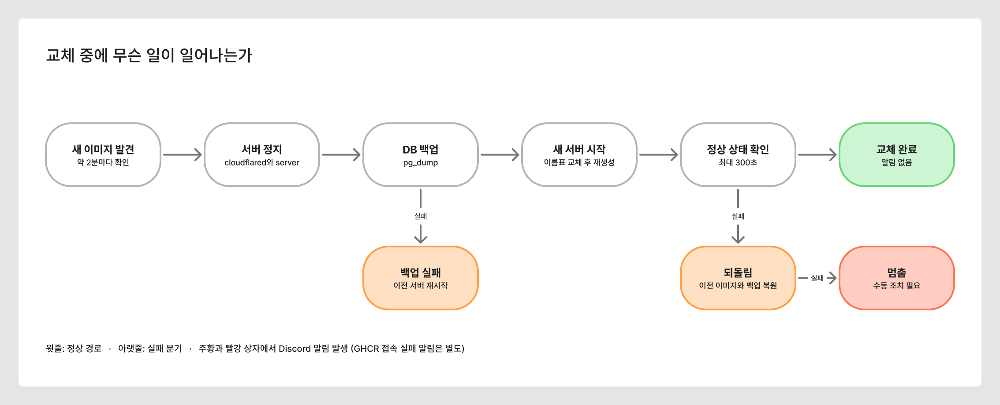

# Windows Docker 서버 설치·교체

집 Windows 데스크톱의 Docker Desktop에서 서버·데이터베이스를 실행하고 Cloudflare Tunnel로 수집기를 연결한다. 사용자는 이 절차의 실제 배포를 맡는다. 기존 서버의 새 버전 교체는 아래 [자동 교체](#자동-교체)를 쓰며, 자동 교체가 실제 집 PC에서 확인될 때까지 [ZIP 교체 절차](#새-계정코드-계약-적용-순서)는 수동 대체 절차로 남긴다. 새 시험 환경은 기존 운영 DB와 분리한다. 기기 등록 이후의 확인은 [Windows 실기 절차](collector-acceptance.md)를 따른다.

기록일: 2026-10-26. 편집·보완일: 2026-10-28, 2026-11-21(자동 교체 절차 추가, ZIP 절차를 수동 대체 절차로 표시), 2026-11-27(자동 교체 절차 도식 추가). 제품의 운영 기준은 [명세](../spec.md#설치운영-설계), 실행 결과는 [준비 검증 보고서](../validation/2026-10-26-collector-acceptance-preparation.md)에 있다.

## 준비할 것

- Docker Desktop을 설치한 집 Windows PC. **Linux 컨테이너 모드**로 실행한다. Java·Node.js를 Windows에 별도로 설치할 필요는 없다.
- Cloudflare에서 관리하는 도메인의 시험용 호스트 이름과 관리 화면에서 만든 원격 관리 Tunnel. 기존 운영 경로와 분리한다.
- 전달받은 `Civil-War-Home-Server.zip`과 `SHA256SUMS-home-server.txt`. ZIP의 해시를 `Get-FileHash -Algorithm SHA256`으로 대조한 뒤 `C:\CivilWarTest` 같은 로컬 폴더에 푼다.

압축을 푼 `home-server` 폴더에는 실행 JAR(자바 묶음)·Dockerfile·Compose 설정·환경 예제가 있다. 이후 PowerShell 명령은 **그 폴더에서** 실행한다. `server.jar`를 직접 실행하거나 JAR 내부를 편집하지 않는다. 원본 설정은 [Compose](../../infra/home-server/compose.yml)와 [Dockerfile](../../infra/home-server/Dockerfile)이다.

## 1. 최초 환경 설정

아래 블록은 새 시험 배포에서 한 번만 실행한다. 기존 `.env`가 있으면 중단한다. 기존 DB의 암호를 파일만 바꿔서 변경할 수는 없다.

```powershell
if (Test-Path -LiteralPath .env) { throw '기존 .env를 유지하세요. 최초 설정을 반복하지 마세요.' }
$cwOrigin = (Read-Host '시험 서버 HTTPS 주소를 입력하세요').Trim().TrimEnd('/').ToLowerInvariant()
if ($cwOrigin -notmatch '^https://[a-z0-9]([a-z0-9.-]*[a-z0-9])?$') {
    throw 'https://시험호스트 형식의 주소만 입력하세요. 경로·포트·계정 정보는 넣지 마세요.'
}
$cwPassword = [Guid]::NewGuid().ToString('N') + [Guid]::NewGuid().ToString('N')
$cwAdminSecure = Read-Host '새 운영자 로그인 코드를 입력하세요(영문·숫자·-_. 8–128자)' -AsSecureString
$cwAdmin = [PSCredential]::new('admin', $cwAdminSecure).GetNetworkCredential().Password
if ($cwAdmin -notmatch '^[A-Za-z0-9._-]{8,128}$' -or $cwAdmin.StartsWith('replace-with-')) {
    throw '운영자 로그인 코드는 영문·숫자·-_. 로만 8–128자로 새로 정하세요.'
}
[IO.File]::WriteAllLines((Join-Path $PWD '.env'), @("SERVER_ORIGIN=$cwOrigin", "POSTGRES_PASSWORD=$cwPassword", "ADMIN_LOGIN_CODE=$cwAdmin"), [Text.UTF8Encoding]::new($false))
Remove-Variable cwPassword, cwAdmin, cwAdminSecure
New-Item -ItemType Directory -Force secrets | Out-Null
$cwToken = Read-Host 'Cloudflare Tunnel 토큰만 붙여넣으세요' -AsSecureString
$cwCredential = [PSCredential]::new('tunnel', $cwToken)
[IO.File]::WriteAllText((Join-Path $PWD 'secrets\cloudflare-tunnel-token.txt'), $cwCredential.GetNetworkCredential().Password.Trim(), [Text.UTF8Encoding]::new($false))
Remove-Variable cwToken, cwCredential
```

운영자 로그인 코드는 이 PC의 `.env`에만 저장되며 서버는 값이 없거나 8자보다 짧으면 시작하지 않는다. 코드·문서·공개 저장소에 적힌 값은 쓰지 않는다. `.env`의 값 해석 차이를 피하려고 이 절차는 영문·숫자·`-`·`_`·`.`만 허용한다.

토큰은 Cloudflare 설치 명령 중 `--token` 다음의 값이다. 설치 명령 전체를 넣지 않는다. `.env`와 `secrets`는 해당 PC에서만 보관하고 공유 ZIP·공개 저장소·시험 결과에 넣지 않는다. 토큰 파일 전달은 [Cloudflare 공식 실행 옵션](https://developers.cloudflare.com/cloudflare-one/networks/connectors/cloudflare-tunnel/configure-tunnels/run-parameters/#token-file)을 따른다.

## 2. 서버·DB 시작

```powershell
docker version
docker compose version
docker compose config --quiet
docker compose up -d --build --wait postgres server
docker compose ps
```

`postgres`와 `server`가 `healthy`인지 확인한다. 처음에는 고정 이미지 다운로드·서버 시작에 시간이 걸린다. 실패하면 `docker compose logs --tail 80 server postgres`에서 오류 종류를 확인한다. 비밀값이 포함될 수 있는 전체 `docker inspect`·환경 설정 출력은 결과로 보내지 않는다.

이 구성에는 호스트로 여는 포트가 없다. DB는 전용 내부 네트워크·영속 볼륨에 있고, 서버는 Tunnel에서 접근한다. 기존 자동 시험의 DB·볼륨과 분리되어 있다. `docker compose down`은 컨테이너를 내리고 볼륨은 남긴다. **`down -v`와 Docker Desktop의 볼륨 삭제는 시험 DB를 지우므로 보존 시험 중 사용하지 않는다.**

## 3. Cloudflare 연결

Cloudflare의 Tunnel 설정에서 시험용 공개 호스트를 추가하고 서비스 주소를 **`http://server:8080`**으로 지정한다. `server`는 같은 Docker 네트워크의 서비스 이름이다. `localhost`를 넣으면 Tunnel 컨테이너 자신을 가리킨다. 외부 사용 주소는 `.env`에 적은 HTTPS 주소와 같아야 한다.

```powershell
docker compose up -d cloudflared
docker compose ps
docker compose logs --tail 30 cloudflared
$cwOrigin = ((Get-Content -LiteralPath .env | Where-Object { $_.StartsWith('SERVER_ORIGIN=') }) -replace '^SERVER_ORIGIN=', '')
Invoke-RestMethod "$cwOrigin/api/members"
```

처음 회원 목록은 빈 배열이다. PowerShell에서 아무 항목도 출력되지 않더라도 HTTP 오류가 없어야 한다. 브라우저에서 같은 주소의 `/admin`을 열어 로그인 화면도 확인한다. Cloudflare Tunnel 상태가 연결됨인지 확인하며, 화면 메뉴가 바뀌면 [공식 배포 안내](https://developers.cloudflare.com/tunnel/get-started/)의 공개 호스트 연결 절차를 따른다.

시험 호스트에 별도의 브라우저 로그인·보안 확인 화면을 적용하면 수집기 요청이 JSON 대신 HTML이나 리다이렉트를 받을 수 있다. `/api/collector/*`에 그런 응답이 없는지 확인한다. 이 서버의 관리자 인증은 `.env`의 운영자 로그인 코드로 한다. 외부 HTTPS만 사용하며 서버의 개발용 HTTP 프로필을 켜지 않는다.

## 4. 최초 관리자 코드와 모임 코드

기존 서버 웹 주소의 `/admin`에서 최초 환경 설정 때 `.env`의 `ADMIN_LOGIN_CODE`에 넣은 운영자 로그인 코드로 로그인한다. 형식과 세션은 [인증 계약](../contracts/api.md#인증과-권한)을 따른다. 코드 발급 명령은 사용하지 않는다. 코드를 바꾸려면 `.env` 값을 고친 뒤 `docker compose up -d --wait server`로 서버를 다시 만들고, 관리자 화면에서 기존 브라우저 세션을 폐기한다.

1. **참가자 관리 → 참가자 추가**에서 실제 Riot ID를 입력한다. 기존 참가자는 같은 프로필을 사용한다. 가능한 포지션은 팀 추천용 별도 설정이다.
2. **코드·인증 → 모임 코드 발급**으로 공통 코드를 한 번 표시하고 수집자에게 전달한다. 수집자별 코드는 만들지 않는다.
3. 수집자는 롤에 로그인한 뒤 수집기의 **모임에 연결**을 사용한다. 현재 계정 관측으로 프로필을 연결하며 과거 경기 이름만으로 합치지 않는다. 상세 입력·게스트 기준은 [명세](../spec.md#참가자와-포지션-관리)를 따른다.
4. 재발급·삭제는 모든 수집기 연결을 해제한다. PC의 대기 자료를 지우지 않고 같은 계정으로 재연결하게 안내한다.

## 5. 중단·재개와 남은 운영 확인

대기 자료를 만들 때는 이 폴더에서 `docker compose stop cloudflared`, 연결을 복구할 때는 `docker compose start cloudflared`를 사용한다. 서버·DB는 계속 켜 둔다. 실제 수집기에서 외부 요청이 실패하는지도 확인해야 한다.

컨테이너에는 재시작 정책이 있으나 Docker Desktop 자체가 실행되지 않으면 시작되지 않는다. Docker Desktop 자동 시작·Windows 절전 설정·PC 재부팅 후 복구, 외부 회선에서의 접속, PC 밖 DB 백업·복원과 프록시의 요청 제한은 별도 운영 확인이다. 이번 시험 서버 실행만으로 완료 처리하지 않는다. 프록시 뒤의 코드 교환 실패 제한은 [현재 인증 계약](../contracts/api.md#인증과-권한)의 한계를 따른다.

## 자동 교체

집 PC가 GHCR(GitHub 컨테이너 이미지 저장소)을 약 2분마다 직접 확인해, master에 병합되어 검사를 통과한 새 서버 이미지로 스스로 교체한다. 바깥에서 집 PC로 들어오는 경로는 없다. 교체 직전에 DB를 백업하고, 새 버전이 정상 상태(`healthy`)가 되지 않으면 백업과 이전 이미지로 되돌린다. 이 기준은 사용자가 확정했고([설계 기록](../superpowers/specs/2026-11-21-ghcr-auto-deploy-design.md)) 제품 기준은 [명세](../spec.md#설치운영-설계)에 있다. 이 절의 절차는 아직 실제 집 PC에서 실행·확인하지 않았다([검증 보고서](../validation/2026-11-21-auto-deploy-report.md)).

알림은 실패 후 되돌림·되돌림 실패(수동 조치 필요)·백업 실패(교체 안 함)·GHCR 접속 지속 실패만 Discord로 온다. **교체 성공은 알리지 않는다.** 그러므로 알림이 없다는 것만으로 교체됐다고 믿지 말고 아래 평소 확인을 한다.



위 도식의 윗줄은 정상 경로, 아랫줄은 실패 분기다. 주황·빨강 상자는 Discord 알림이 오는 단계이며, GHCR 접속 지속 실패 알림은 교체 절차 밖이라 도식에 없다. 도식의 출처와 갱신 방법은 [명세의 구성과 책임](../spec.md#구성과-책임)에 있다.

### 최초 전환(한 번, 사람이 실행)

자동 교체는 새 `compose.yml`이 집 PC에 있어야 시작되므로 첫 전환은 손으로 한다. 이 전환 중 서버가 몇 분 멈추며 수집기 전송은 지연된다(기록 손실은 아님). 명령은 **기존 배포 폴더**의 PowerShell에서 실행한다.

1. GitHub의 패키지 설정에서 `civil-war-server`와 `civil-war-updater` 이미지가 공개인지 확인하고, 비공개면 공개로 바꾼다. 처음 만들어진 패키지의 기본 공개 여부는 확인하지 않았다. 공개가 아니면 아래 `docker pull`이 로그인을 요구한다.
2. Discord 서버 설정에서 웹훅을 만들고, 주소를 붙여넣어 `secrets\discord-webhook-url.txt`에 저장한다. 위 최초 환경 설정의 Tunnel 토큰 저장과 같은 방식이라 주소가 화면·명령 기록에 남지 않는다. 이 파일은 `.env`·`secrets`처럼 공유 ZIP·저장소에 넣지 않는다.

   ```powershell
   New-Item -ItemType Directory -Force secrets | Out-Null
   $cwHook = Read-Host 'Discord 웹훅 주소만 붙여넣으세요' -AsSecureString
   $cwCredential = [PSCredential]::new('webhook', $cwHook)
   [IO.File]::WriteAllText((Join-Path $PWD 'secrets\discord-webhook-url.txt'), $cwCredential.GetNetworkCredential().Password.Trim(), [Text.UTF8Encoding]::new($false))
   Remove-Variable cwHook, cwCredential
   ```

   교체 담당은 이 파일을 **시작할 때만** 읽는다. 나중에 주소를 바꾸면 `docker compose up -d --force-recreate updater`(또는 `docker compose restart updater`)로 다시 시작해야 반영된다.

   또 `.env`에 `ADMIN_LOGIN_CODE`가 있는지 확인한다. 새 서버 이미지는 이 값이 없으면 시작하지 않는다. 없으면 [운영자 로그인 코드 추가](#2-기존-설정으로-서버-교체)의 블록으로 먼저 추가한다(`compose.yml`의 `server.environment`에는 새 파일이 이미 항목을 포함한다).

   ```powershell
   Select-String -LiteralPath .env -Pattern '^ADMIN_LOGIN_CODE=' -Quiet
   ```

   `True`가 나오면 있는 것이다.
3. 서버·Tunnel을 멈추고 백업한다. [쓰기 중단과 백업](#1-쓰기-중단과-백업) 절차를 그대로 따른다.
4. 새 `compose.yml`을 저장소 master에서 받아 기존 폴더에 덮어쓴다(위 3번 백업에 기존 파일이 들어 있다). `.env`·`secrets`·프로젝트 이름(`cw-collector-acceptance`)은 바꾸지 않는다. 기존 `compose.yml`에 직접 추가했던 설정이 있으면 백업본과 비교한다.

   ```powershell
   Invoke-WebRequest -Uri 'https://raw.githubusercontent.com/SangHyeok0908/Civil-War/master/infra/home-server/compose.yml' -OutFile compose.yml
   docker compose config --quiet
   ```

5. 서버 이미지를 받아 실행용 이름표를 붙이고 전체를 시작한다. 새 `compose.yml`의 서버는 `civil-war-server:current` 이름표를 쓰며 집 PC에서 빌드하지 않는다.

   ```powershell
   docker pull ghcr.io/sanghyeok0908/civil-war-server:master
   docker tag ghcr.io/sanghyeok0908/civil-war-server:master civil-war-server:current
   docker compose up -d --wait
   docker compose ps
   ```

6. 웹훅 주소가 맞는지 시험 알림을 한 번 보낸다. Discord에 시험 메시지가 오면 정상이다.

   ```powershell
   docker compose run --rm updater --test-alert
   ```

   로그에 `alert failed: test`가 나오고 종료 코드가 0이 아니면 웹훅 파일이 없거나 주소가 틀린 것이다.

**전환이 실패하면**(서버가 정상 상태가 되지 않는 경우 등) 새 서버가 DB를 건드렸는지부터 `docker compose logs --tail 80 server postgres`로 본다. DB 복원은 하지 않고, 전환 전 백업해 둔 설정·실행 파일로만 되돌린다. 3번에서 백업한 폴더(`$env:USERPROFILE\CivilWarBackups\<시각>`)를 쓴다.

```powershell
docker compose stop updater cloudflared server
$cwBackupRoot = Get-ChildItem (Join-Path $env:USERPROFILE 'CivilWarBackups') -Directory | Sort-Object Name | Select-Object -Last 1 -ExpandProperty FullName
Copy-Item -LiteralPath @('compose.yml', 'Dockerfile', '.dockerignore', 'server.jar' | ForEach-Object { Join-Path $cwBackupRoot $_ }) -Destination . -Force
docker compose up -d --build --wait --remove-orphans postgres server
docker compose ps
docker compose start cloudflared
```

가장 최근 백업 폴더가 맞는지 시각을 확인한다. `--remove-orphans`는 옛 `compose.yml`에 없는 `updater` 컨테이너만 지우며 DB 볼륨은 지우지 않는다. 되돌린 뒤 원인을 파악하기 전에는 `docker compose down -v`나 볼륨 삭제를 하지 않는다.

### 평소 확인

성공 알림이 없으므로 병합 후 반영 여부는 직접 본다. 비밀값이 섞일 수 있는 `docker inspect` 전체 출력은 쓰지 않고, 아래처럼 라벨만 출력한다.

```powershell
docker compose logs --tail 50 updater
docker inspect --format '{{ json .Config.Labels }}' (docker compose ps -q server)
```

출력의 `org.opencontainers.image.revision` 값이 실행 중 서버 이미지의 원본 커밋이며, GitHub의 master 커밋과 대조하는 것이 반영 여부의 최종 확인이다. 교체 담당이 직접 남기는 줄에는 시각이 붙는다(Docker·Compose가 내는 출력은 시각이 없을 수 있다). 교체 성공 확인에는 `교체 완료: <커밋 앞 7자>`, 시작에는 `교체 시작: <커밋 앞 7자>`가 쓰인다. 되돌렸다면 `되돌림 완료: <커밋 앞 7자>`가 남고 Discord에도 알림이 온다. 교체 도중 교체 담당이 재시작되면 `재시작 복구: <단계>`가 남는다. 실패 단계는 `새 버전 시작 실패`·`백업 실패` 같은 줄과 `alert sent|skipped|failed: <종류>`로, 이미 되돌린 이미지는 `이전에 되돌린 이미지라 다시 시도하지 않습니다.`로 남는다. 이 줄은 `:master`가 실패한 이미지인 동안 매 주기(약 2분)마다 반복되며, 새 이미지가 올라오거나 `--retry`를 실행하기 전까지는 정상이다. 커밋 정보를 읽지 못하면 `unknown`으로 적힌다.

교체 담당이 살아 있는지는 로그가 아니라 `docker compose ps updater`의 상태가 `running`인지로 확인한다. 새 이미지가 없으면 로그에 아무것도 남지 않는 것이 정상이므로, 조용한 로그만으로 멈췄다고 판단하지 않는다. `updater`가 `running`이 아니면 멈춘 것이며 이때도 알림은 오지 않는다.

### 멈춤 상태의 수동 조치

되돌림도 실패하면 Discord에 "수동 조치 필요"가 오고, 서버는 멈춘 채로 자동 교체도 멈춘다. 공개 조회·관리는 쓸 수 없고 수집기 자료는 각 PC에 보존된다. 아래는 **운영 DB를 덮어쓸 수 있는 작업**이므로 실행 전에 담당자와 함께 진행 여부를 정한다. 복원은 자동 되돌림 실패 뒤의 명시적인 수동 작업이며, 백업 파일은 지우지 않는다. `docker compose down -v`와 볼륨 삭제는 하지 않는다. 명령은 배포 폴더의 PowerShell에서 실행한다.

1. 실패한 단계(`step`)는 Discord 알림이나 `docker compose logs --tail 80 updater`에서 읽고, `backupFile`·`previousId`·`candidateId`는 `backups\updater-state.json`에서 읽는다.

   ```powershell
   Get-Content backups\updater-state.json
   ```

2. 터널과 서버를 멈춘 채로 둔다.

   ```powershell
   docker compose stop cloudflared server
   ```

3. `step`이 `stop` 또는 `tag`이면 `:current`가 실패한 새 이미지를 가리킬 수 있으므로 이전 이미지로 돌린다. 다른 단계면 건너뛴다. `:previous` 이름표는 되돌림이 이름표를 다시 붙이기 전에 실패했다면 옛 값일 수 있으므로 쓰지 않고, 1단계에서 읽은 `previousId`(이미지 ID)를 그대로 쓴다.

   ```powershell
   docker tag <previousId> civil-war-server:current
   ```

4. `step`이 `stop`·`tag`·`restore`이고 `backupFile`이 있으면 그 백업으로 DB를 복원한다. `start-previous`이거나 `backupFile`이 `null`이면 복원할 것이 없으므로 건너뛴다. 복원은 교체 담당 이미지의 `--restore` 명령을 쓴다. 이 명령은 상태가 멈춤(`halted`)일 때만 실행되고, 백업을 임시 파일로 변환한 뒤에만 기존 DB의 `public` 스키마를 지우고 한 트랜잭션으로 복원하므로 깨진 백업은 DB를 건드리지 않고 실패한다. `<backupFile>`은 `20261121-030405-abcdef1.dump` 같은 파일 이름만 쓴다(경로 없이 `backups\` 폴더의 자동 백업 이름만 허용).

   ```powershell
   docker compose up -d --wait postgres
   docker compose run --rm updater --restore <backupFile>
   ```

   `복원 완료` 줄이 나오고 종료 코드가 0일 때만 다음으로 간다. 실패하면 서버를 시작하지 말고 로그를 담당자와 확인한다.

5. 서버를 시작하고 `healthy`인지 확인한 뒤 터널을 켠다. 마지막으로 멈춤을 푼다.

   ```powershell
   docker compose up -d --no-deps --force-recreate --wait server
   docker compose ps
   docker compose start cloudflared
   docker compose run --rm updater --reset
   ```

   교체가 진행 중인 상태에서는 `--reset`·`--retry`가 거부된다(종료 코드 1).

`상태 파일을 읽을 수 없어 교체를 멈춥니다` 로그와 `state-file` 알림이 온 경우는 위 단계가 아니라 `backups\updater-state.json`이 깨진 것이다. 서버가 정상(`healthy`)인지 먼저 확인하고, 교체 중에 깨진 것은 아닌지 담당자와 확인한 뒤 `--reset`을 실행하면 상태 파일이 기본값으로 다시 만들어진다.

#### `--reset`과 `--retry`

- `--reset`: 수동 조치를 마친 뒤 멈춤(`halted`)만 푼다. 실패한 이미지는 계속 막아 두므로 `:master`가 같은 이미지인 동안은 다시 시도하지 않는다.
- `--retry`: 실패한 이미지의 재시도를 허용한다. 상태가 멈춤이어도 함께 풀리므로 서버가 `healthy`인 것을 확인한 뒤에만 쓴다. 이미 같은 `:master`를 다시 시도하고 싶을 때 쓰며, "백업 실패(교체 안 함)"나 "실패 후 되돌림" 알림 뒤에 원인을 해결하고 같은 이미지를 다시 시도할 때도 이 명령이다.

```powershell
docker compose run --rm updater --retry
```

두 명령은 `docker compose run --rm updater` 한 번 실행으로 끝나며 교체 반복을 새로 시작하지 않는다. `updater` 서비스는 주기마다 상태 파일을 다시 읽으므로 다음 주기(약 2분 이내)에 반영된다. 알 수 없는 인자는 사용법을 출력하고 종료 코드 2로 끝난다.

### 교체 담당의 수동 갱신

교체 담당 이미지는 자동 교체 대상이 아니다. 바꿀 때만 직접 갱신한다.

```powershell
docker compose pull updater
docker compose up -d updater
```

### 알려진 제한

- 성공 알림이 없어서, 교체 담당이나 Docker Desktop이 멈추면 아무 알림 없이 병합한 변경이 반영되지 않은 채 남는다.
- 교체마다 서버가 몇 분 멈춘다. 공개 조회·관리는 쓸 수 없고 수집기 전송은 지연된다.
- 서버 검사의 경로 조건에 걸리지 않는 변경(문서·수집기만 변경 등)은 이미지를 만들지 않으므로 집 서버도 교체되지 않는다. 이미지는 서버 검사 작업이 통과한 master 푸시에서만 올라가며, 다른 검사 작업의 결과는 이미지 게시 조건이 아니다.
- 교체 담당 컨테이너는 Docker 제어 통로(`/var/run/docker.sock`)를 쓴다. 이는 이 PC의 Docker 전체 제어권이므로 저장소에서 만든 이미지만 쓰고 수동으로 갱신한다.
- `backups\`(교체 직전 백업, 최근 10개 보관)와 `secrets\`는 공유 ZIP·저장소에 넣지 않는다.
- PostgreSQL·Tunnel 이미지는 자동 갱신하지 않고 고정 버전을 수동으로 올린다.

## 개발 환경에서 묶음 재생성

이 절과 아래 ZIP 교체 절차는 [자동 교체](#자동-교체)가 집 PC에서 확인되기 전까지의 수동 대체 절차다. 자동 교체로 전환한 PC의 `compose.yml`에는 `build`가 없으므로 아래 `up -d --build`·`server.jar` 복사를 그대로 쓸 수 없다.

저장소의 고정 도구로 서버를 빌드한 뒤 아래 허용 파일만 새 폴더에 복사해 ZIP으로 묶는다. 실제 `.env`·토큰·DB·사용자 자료는 포함하지 않는다.

```sh
./apps/server/gradlew -p apps/server bootJar
mkdir -p dist/home-server
cp infra/home-server/Dockerfile infra/home-server/compose.yml infra/home-server/.env.example infra/home-server/.dockerignore dist/home-server/
cp apps/server/build/libs/civil-war-server-*-provisional.jar dist/home-server/server.jar
```

JAR 후보가 여러 개라면 현재 빌드 설정의 실행 JAR 하나를 명시한다. `-plain.jar`는 사용하지 않는다. 배포 ZIP에는 `home-server/` 아래 위 설정 4개와 `server.jar`만 넣는다. ZIP 해시는 파일 생성 후 별도로 계산한다.

## 새 계정·코드 계약 적용 순서

수동 대체 절차다. 자동 교체 전환 전의 PC에서 쓰며, 전환 후에는 서버 교체 대신 1단계 백업과 3단계 수집기 연결만 쓴다.

자동 교체 담당(`updater`)이 이미 실행 중인 PC에서 이 절차를 쓰면 교체 담당이 GHCR 이미지로 서버를 다시 바꿀 수 있으므로, **먼저 `docker compose stop updater`로 멈추고** 절차를 마친 뒤 `docker compose start updater`로 다시 켠다.

이 절차는 기존 Windows·Docker 서버와 수집기를 교체할 때 사용한다. ZIP은 새 폴더에 풀어 실행 파일을 준비한다. 기존 서버의 Compose 프로젝트·DB·볼륨·환경 설정과 각 PC의 수집기 자료 경로를 유지한다. 새 서버 구축은 앞의 최초 환경 설정 절차를 따른다.

### 1. 쓰기 중단과 백업

모든 수집기를 종료한다. **기존 서버 배포 폴더**의 PowerShell에서 외부 연결과 서버를 멈추고 DB 컨테이너는 유지한다.

```powershell
docker compose stop cloudflared server
$cwBackupRoot = Join-Path $env:USERPROFILE ('CivilWarBackups\' + (Get-Date -Format 'yyyyMMdd-HHmmss'))
New-Item -ItemType Directory -Path $cwBackupRoot | Out-Null
Copy-Item -LiteralPath @('.env', 'compose.yml', 'Dockerfile', '.dockerignore', 'server.jar') -Destination $cwBackupRoot
if (Test-Path -LiteralPath 'secrets') { Copy-Item -LiteralPath 'secrets' -Destination $cwBackupRoot -Recurse }
docker compose exec -T postgres sh -c 'pg_dump -U "$POSTGRES_USER" -d "$POSTGRES_DB" -Fc -f /tmp/civil-war-before-ux.dump'
if ($LASTEXITCODE -ne 0) { throw 'DB 백업 실패. 적용을 멈추세요.' }
docker compose cp postgres:/tmp/civil-war-before-ux.dump (Join-Path $cwBackupRoot 'database.dump')
if ($LASTEXITCODE -ne 0) { throw 'DB 백업 복사 실패. 적용을 멈추세요.' }
```

각 수집기 PC에서도 앱 종료 후 `%APPDATA%\Civil War Collector` 폴더 전체를 별도 백업한다. 서버 DB 백업과 수집기 대기는 서로 다른 자료다. 백업을 새 격리 DB·복사 폴더에 복원해 회원·등록/취소 경기·원문·대기 요청·초안을 대조하는 것이 적용 전 확인 기준이다.

### 2. 기존 설정으로 서버 교체

ZIP의 `home-server/server.jar`를 기존 배포 폴더의 `server.jar`에 복사한다. 기존 `.env`, `secrets`, `compose.yml`, `Dockerfile`, `.dockerignore`를 사용한다. ZIP의 설정 네 파일은 최초 구성과 대조할 때 쓰는 예제다. 사용자별 프로젝트명·DB·볼륨을 새 이름으로 바꾸지 않는다.

자동 솔로랭크 참고를 사용할 때는 서버 `.env`에 `RIOT_API_KEY`를 넣고, 기존 `compose.yml`의 `server.environment`에 다음 항목을 추가한다. 실제 키는 배포 ZIP·수집기 설정에 넣지 않는다. 키가 없거나 조회가 실패하면 연결·조회 대기와 최근 성공값 또는 공통 시작값을 사용한다. 키를 다른 키로 바꾸면 Riot이 같은 계정에도 다른 PUUID를 돌려준다. 서버는 다음 팀 추천 때 참가자마다 저장 값을 새 키 기준으로 바꾸므로 따로 할 일은 없고, 그 추천 한 번은 참가자당 Riot 호출이 한 번 더 생긴다.

```yaml
RIOT_API_KEY: ${RIOT_API_KEY:-}
```

새 서버는 운영자 로그인 코드를 `.env`의 `ADMIN_LOGIN_CODE`에서 읽으며 값이 없으면 시작하지 않는다. 기존 `.env`에 이 값이 없으면 아래 블록으로 추가하고, 기존 `compose.yml`의 `server.environment`에도 다음 항목을 넣는다. 이전 고정값처럼 공개된 값은 쓰지 않는다.

```powershell
if (Select-String -LiteralPath .env -Pattern '^ADMIN_LOGIN_CODE=' -Quiet) { throw '이미 ADMIN_LOGIN_CODE가 있습니다. 기존 값을 유지하세요.' }
$cwAdminSecure = Read-Host '새 운영자 로그인 코드를 입력하세요(영문·숫자·-_. 8–128자)' -AsSecureString
$cwAdmin = [PSCredential]::new('admin', $cwAdminSecure).GetNetworkCredential().Password
if ($cwAdmin -notmatch '^[A-Za-z0-9._-]{8,128}$' -or $cwAdmin.StartsWith('replace-with-')) {
    throw '운영자 로그인 코드는 영문·숫자·-_. 로만 8–128자로 새로 정하세요.'
}
[IO.File]::AppendAllText((Join-Path $PWD '.env'), "ADMIN_LOGIN_CODE=$cwAdmin`n", [Text.UTF8Encoding]::new($false))
Remove-Variable cwAdmin, cwAdminSecure
```

```yaml
ADMIN_LOGIN_CODE: ${ADMIN_LOGIN_CODE:?Set ADMIN_LOGIN_CODE in .env}
```

기존 서버 폴더에서 실행한다. Docker Desktop은 Linux 컨테이너 모드여야 한다.

```powershell
docker compose config --quiet
docker compose up -d --build --wait postgres server
docker compose ps
```

서버 시작 때 미적용 DB 전환만 수행한다. 0.3에서 0.4로 교체할 때 회원·경기·취소·기기 인증·관리자 세션을 유지하고 DB 구조를 바꾸지 않는다. 개인별 코드 방식의 더 오래된 버전에서 처음 전환하면 해당 이전 전환 규칙에 따라 개인 코드와 기기 자격이 해제된다. 연결 누락으로 전환이 실패하면 자료를 버려 계속하지 않는다. **`docker compose down -v`와 볼륨 삭제는 실행하지 않는다.**

### 3. 모임 코드와 새 수집기 연결

서버가 `healthy`이면 `docker compose start cloudflared`로 기존 외부 연결을 시작한다. 기존 웹 주소에서 `.env`의 운영자 로그인 코드로 로그인해 모임 코드를 발급한다. 이전 43자리 코드도 새 수집기의 입력 팝업에서 사용할 수 있다. 6자리 코드로 바꾸려면 재발급한다. 재발급은 기존 모든 수집기를 해제하므로 새 코드를 배포할 시점에 수행한다. 서버 버전 교체만으로 기존 기기·브라우저 세션을 해제하지 않는다.

ZIP의 `collector` 폴더에 있는 새 설치 파일을 같은 Windows 사용자로 더블클릭한다. 설치를 마치면 바로가기가 생성되고 앱이 실행된다. 이후 바탕화면 아이콘으로 실행하며 서버 주소를 입력하지 않는다. 기존 수집기 자료 폴더와 참가자 프로필을 그대로 사용한다. 롤에 로그인한 상태에서 팝업에 새 모임 코드를 입력하면 같은 참가자·계정의 저장 요청을 자동으로 이어 보낸다. 정상 연결 후에는 코드 입력 폼을 숨긴다.

서버와 PC의 기존 기록·포지션·대기 건수·계산 상태를 대조한다. 새 경기 수집이나 새 참가자 계정 확인에는 **롤에서 경기 가져오기**를 사용한다. 이미 등록을 요청한 경기만 자동 처리되고 확인 대기 경기는 직접 등록한다.

프로토콜 2를 지원하지 않는 구형 수집기는 새 서버에서 업데이트 필요 응답을 받는다. 새 모임 코드를 재발급·삭제하면 모든 수집기가 다시 연결해야 한다. 모임 코드는 발급 때 한 번만 보여 준다.

### 4. 확인 범위와 되돌리기

이 배포물은 macOS에서 빌드·무결성 검사한 Windows x64 설치판이며 코드 서명은 없다. 실제 Windows 설치 실행, 새 LCU 현재 이름 조회 경로와 Riot 키 실연동, 운영 서버 적용은 이 ZIP 생성으로 확인된 결과가 아니다.

문제가 생기면 쓰기를 멈춘 상태를 유지하고 보관한 서버·수집기 백업과 그에 맞는 프로그램 버전을 함께 복원한다. 새 DB에 예전 프로그램을 역실행하지 않는다. 적용 후 새로 생긴 자료는 별도로 보관해 복원 시 잃지 않도록 대조한다.
