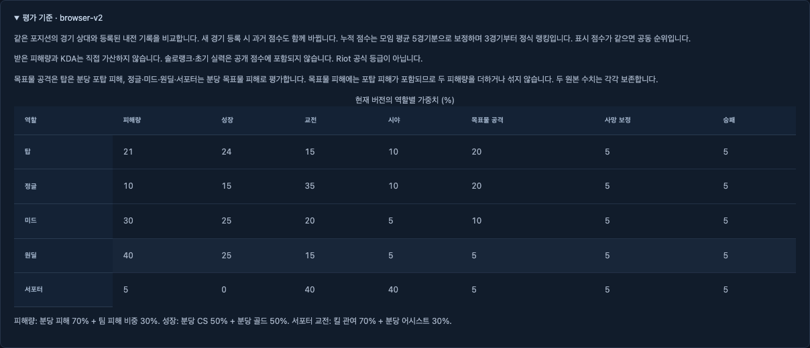

# 확정 평가 기준 반영·전체 재계산 검증

기록일·실행일: **2026-10-26**. 편집·보완일: **2026-10-26**. 현재 상태는 [진행 상태](../status.md), 제품 규칙은 [평가 명세](../spec.md#경기별-활약-점수), 통신·이전 동작은 [현재 API 계약](../contracts/api.md#계산-규칙-검증게시복구)이 정본이다.

사용자는 확정한 포지션별 평가 기준과 적용 버전을 화면에서 확인할 수 있다. 이미 보관한 수치로 등록 유효 경기를 모두 다시 계산하며, 이전 점수·가중치·원본을 보존한다. 지표 수식은 기존 임시 구현과 같아 이번 전환 전후 점수의 수치 변화는 없다.

| 분류·상태 | 주체·근거 | 이번 확인 | 지금 판단할 사항 |
| --- | --- | --- | --- |
| 사용자 확정·유지 | 사용자, [D24](../superpowers/decisions/2026-10-22-overnight-decisions.md#d24--2026-10-24-목표물-공격-평가-기준-사용자-확정) | 기존 포지션별 지표를 재승인 없이 반영 | 없음 |
| 위임받은 선택·구현 | 실행 담당자, [실행 계획](../superpowers/plans/2026-10-26-confirmed-objective.md) | DB 이전으로 새 규칙·영속 작업을 함께 생성 | 별도 운영 서버 적용은 미실행 |
| 조사 및 검증·로컬 확인 | 실행 담당자, 아래 실행 결과 | 실제 PostgreSQL에서 전환·보존·재계산 확인 | 공정성 비교나 새 Windows 실험 결과는 아님 |

## 환경과 자료 범위

macOS arm64, OpenJDK 25.0.1, PostgreSQL 18.6의 격리 DB `cw_test`와 실제 JAR(자바 실행 묶음)을 사용했다. 브라우저 검사는 별도 `cw_web_test`와 Chromium을 사용한다. JavaScript 검사는 번들 Node.js 24.19.0·pnpm 11.5.0에서 실행했다. 저장소가 지정한 Node.js 24.22.1과 달라 버전 경고가 있었으며 해당 정확한 버전의 재실행 결과로 표현하지 않는다. 초기 실패 재현은 시스템 Node.js 23.11.0으로 실행했다. 최종 Node.js 24.19.0 웹 빌드의 파일명·내용 해시는 기존 패키지와 같았다.

재계산 자료는 [보존 후보 G1–G3](../../fixtures/lcu/candidates/h2-20261021/manifest.json)의 실측 수치다. 세 파일의 SHA-256 해시(파일 내용 대조값)가 설명 파일과 일치했다. 경기 키·시각·계정은 가명이며 포지션은 테스트에서 지정했다. 실제 경기의 최종 포지션 정확도나 G2·G3 화면 대조를 새로 검증한 것은 아니다. League·Riot에 새 조회를 보내지 않았다.

## DB 이전과 재계산 결과

[실제 DB 테스트](../../apps/server/src/test/java/cw/evaluation/ConfirmedScoringMigrationIntegrationTest.java)의 4개 사례에서 다음을 확인했다. 검증 결과의 새 규칙과 참가 기록별 점수는 [재계산 결과 JSON](assets/confirmed-objective-generation.json)에 보존했다. 이 자료는 이번 격리 실행의 결과이며 현재 운영 상태를 나타내지 않는다.

- 조정 규칙을 선택한 DB에서 탑 피해·성장 가중치 21·24와 피해 내부 비율 0.6·0.4를 그대로 복사했다. 정규화 상수와 누적 보정도 유지했다. 새 규칙의 알고리즘은 `objective-position-v1`이다.
- 저장 경기 5건 중 등록 유효 경기 G1–G3만 계산했다. 취소 경기 1건과 확인 대기 1건은 제외했다. 유효 3경기 × 10명 = **참가 기록별 점수 30개**가 모두 새 버전을 사용했다. 전환 전후 반올림 전 점수·순위·7개 항목별 값·회원 누적 통계·포지션 실력값이 일치했다.
- 전체 경기의 원본 JSON·정규화 JSON·참가자·상태, 이전 규칙 JSON, 이전 평가 세대 JSON을 전환 전후 대조해 변경이 없음을 확인했다.
- 입력 변경 번호가 1 증가하고, 이전 활성 세대가 비워지며 pending(대기) 작업이 생성됐다. 작업 완료 후 succeeded(성공)가 됐고 중복 실행은 버전·변경 번호·작업 수를 늘리지 않았다.
- 이전 기본 규칙이 선택됐지만 평가 세대가 없는 DB도 전환됐다. 빈 DB는 새 기본 규칙으로 시작하고 이미 확정 규칙을 쓰면 재전환하지 않았다.
- 작업 삽입을 강제로 실패시켰을 때 새 규칙·선택 버전·변경 번호·작업이 부분 반영되지 않았다. 실패 원인을 제거한 뒤 전환·재계산이 성공했다. 이는 실제 DB 트리거로 만든 오류이며 외부 장애 실측과 구분한다.

[다섯 포지션 검사](../../apps/server/src/test/java/cw/domain/ScoringServiceTest.java)는 서로 다른 목표물·포탑 수치로 항목별 기대값과 분당 환산값을 확인한다. [재계산 회귀 검사](../../apps/server/src/test/java/cw/evaluation/RecalculationIntegrationTest.java)는 과거 버전 신규 선택 거절, 늦은 세대 게시 차단과 중단 작업 복구를 포함한다. 과거 규칙 조회·계산은 호환한다.

## 전체 실행 결과와 화면

서버 `spotlessApply build`와 최종 `clean build`는 **테스트 119개, 실패·오류·건너뜀 0개**였다. 여기서 개수는 JUnit의 실행 테스트 사례 수이며, 다섯 포지션의 매개변수 사례도 각각 센다. 실제 HTTP(웹 요청), PostgreSQL, 실행 JAR의 관리자 복구 검사가 포함된다. [생성 XML](../../apps/server/build/test-results/test/TEST-cw.evaluation.ConfirmedScoringMigrationIntegrationTest.xml)과 [전체 HTML 보고서](../../apps/server/build/reports/tests/test/index.html)는 로컬 생성 증거다.

`pnpm test`는 7개 파일의 **테스트 사례 60개**가 통과했고 `pnpm typecheck`도 통과했다. `pnpm test:web`는 **15개 사례**가 모두 통과했다. 이 중 12개는 실제 서버·HTTP·PostgreSQL·Chromium 연동이며, `ui-states.fixture.spec.ts`의 3개는 응답 상태 주입 검사다. 운영자 가중치 저장·확정 알고리즘 유지·임시 버전 생성의 422 거절과 경기 상세·랭킹·개인 화면의 지표 설명을 확인했다. `pnpm test:docs`의 검사기 회귀 사례 66개, `pnpm docs:check`, `pnpm format:check`도 통과했다. Java 형식·가독성 검사는 서버 빌드에 포함했다.

위 이미지는 브라우저 검사 중 운영자가 탑 피해·성장 가중치를 21·24로 조정한 뒤의 화면이다. 제품의 초기 기본 가중치를 바꾼 근거가 아니다.

브라우저 전체 검사 종료 후 [읽기 전용 SQL 대조](assets/confirmed-objective-db-audit.json)로 격리 DB의 등록 경기 **12건·참가 기록별 점수 120개**를 직접 확인했다. 계산에서 빠진 등록 경기 0건, 버전이 섞인 점수 0개, 확인 대기·취소 경기의 점수 포함 0건이었다. 이 12건은 웹 검사기가 만든 합성 경기이며 위 실측 수치 G1–G3의 3건과 합산하지 않는다. 조회문과 실제 결과를 함께 보존했다.

새 버전·임시 버전 신규 선택 거절 테스트 2개가 구현 전에 실패했다. 화면 회귀도 기존 ‘잠정 기준’과 분당 단위 누락으로 실패한 뒤 수정했다. 전체 브라우저 실행에서는 앞선 취소 직후 `202 RECALCULATING` 응답을 기다리지 않는 새 테스트의 결함을 확인해 완료 응답 대기를 추가했다. 제품의 계산 중 정책은 유지했다. DB 검사 초기에 저장 전 Double과 저장 후 정확한 소수 JSON 표현을 직접 비교해 실패한 테스트는 저장 표현끼리 비교하도록 고쳤다. 수치 보존 조건은 완화하지 않았다.

독립 검토 에이전트는 DB 이전 원자성·조정값 보존·과거 호환·늦은 게시 차단·스키마·화면을 검토했고 중요한 구현 오류를 찾지 못했다. 별도 DB 테스트를 동시에 실행하지 않았으며 실행 성공 판정은 위 담당자의 실제 결과에 근거한다.

## 한계와 남은 필수 작업

별도 운영 서버 주소·접속 정보가 제공되지 않아 운영 DB 적용이나 운영 경기 수의 전수 대조는 수행하지 않았다. 이번 검증은 보관한 G1–G3 전체와 격리 DB의 합성 상태에 한정한다. 배포한 서버는 시작 시 DB 이전 후 저장된 모든 등록 유효 경기를 재계산하도록 구현했다. 적용 중에는 기존 계산 중 응답을 사용하고 예전 점수를 현재 점수로 공개하지 않는다.

설치·외부 접속·복원 등 남은 운영 검증과 사용자 제외 범위는 [현재 상태](../status.md#남은-작업-순서)에서 관리한다. 평가 기준 확정과 구현 완료를 운영 준비 완료나 새로운 사용자 승인으로 확대하지 않는다.
