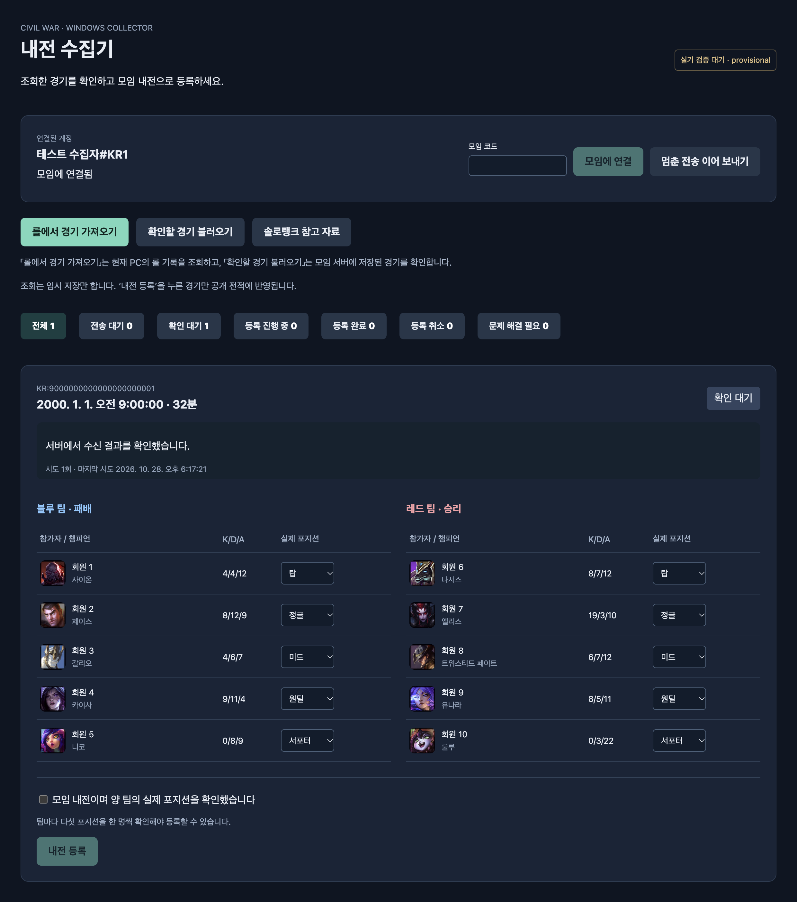
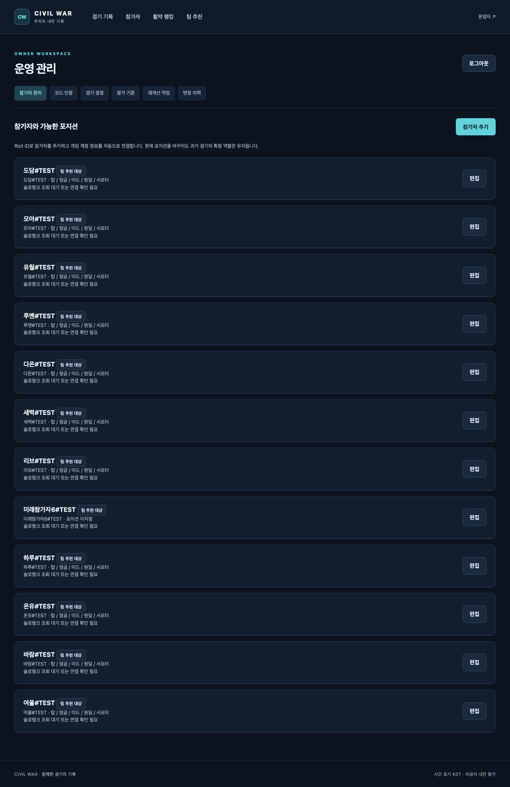

# 참가자 등록과 수집기 흐름 구현 검증

Riot ID로 참가자를 추가하고, 등록자 여섯 명 이상인 경기를 게스트와 함께 확인해 등록할 수 있도록 바꿨다. 공통 코드·포지션 제안·챔피언 표시·전송과 계산 상태·목록 필터를 연결했다. 기존 자료의 보존 검사는 운영 자료를 건드리지 않는 격리 환경에서 수행했다.

기록일·편집일: 2026-10-28. 구현 기준은 [명세](../spec.md), 실행 순서는 [계획](../superpowers/plans/2026-10-28-ux-improvements.md), 선택 이유는 [결정 기록](../superpowers/decisions/2026-10-28-ux-requirements.md#실행-보완과-채택한-세부안)이다. 아래 수치는 이 실행의 근거이며 이후 [현재 상태](../status.md)의 정본을 대신하지 않는다.

| 분류·주체 | 상태 | 지금 판단할 사항 |
| --- | --- | --- |
| 사용자 확정 · 사용자 | 확정한 동작을 코드에 반영하도록 지시 | 재승인 없음 |
| 위임받은 선택 · 개발 담당자 | 계정 분리·등급 정책·로컬 자산·인증 제한 채택 | 운영 자료에서 정확도·제약이 드러나면 연결한 결정의 조건으로 재검토 |
| 조사 및 검증 · 개발 담당자 | 자동 검사 완료, 독립 검토 대기 | 독립 검토 결과를 최종 보완 |

## 실행 환경과 자료 보존

macOS에서 저장소의 Node·Electron·Java 설정을 사용했다. 별도 관리 작업 공간 `codex/participant-collector-ux`에서 구현하고, PostgreSQL은 전용 Compose 프로젝트 `cw-ux-test`와 로컬 포트 55442를 사용했다. 서버 통합 검사는 `cw_test`, 브라우저 실행기는 `cw_web_test`만 초기화한다. 원래 작업 폴더의 미커밋 계획 문서와 사용자 서버·PC 자료는 변경하지 않았다.

[전환 검사](../../apps/server/src/test/java/cw/accounts/PlayerAccountMigrationIntegrationTest.java)는 이전 DB 형식에 회원 10명, 등록·대기·취소 경기 각 1건과 참가 행 30개를 만든 뒤 새 전환 파일을 적용한다. 회원·경기 키, 원문 소수 문자열, 정규화 자료와 상태가 같은지 비교한다. 관리자 세션은 보존되고 옛 개인 코드·기기 자격만 해제되는지, 새 연결 열이 필수인지도 확인한다. [새 전환 파일](../../apps/server/src/main/resources/db/migrations/V8__require_player_links.sql)은 연결 누락을 버리지 않고 실패시킨다.

[파일 SQLite 검사](../../apps/collector/src/main/outbox.test.ts)는 이전 로컬 구조를 다시 열어 원문 정밀도·소유 계정·원래 기기 키·제출 식별자·수동 초안을 비교한다. 승인된 같은 계정의 새 연결만 기존 요청을 이어 보낼 수 있다. [실제 HTTP 통합 흐름](../../tests/web/zy-ux-flow.spec.ts)은 코드 교체 뒤 앱 저장소를 다시 열고 이 보존값을 대조한 다음 등록까지 진행한다. 운영 DB 백업·복원 실행은 하지 않았으며 적용 절차는 [서버 안내](../runbooks/home-server.md#새-계정코드-계약-적용-순서)로 분리했다.

## 요구사항과 검사 근거

| 목표 | 확인한 상황과 결과 | 근거 |
| --- | --- | --- |
| R01–R04 참가자 입력·자동 시작값 | 새 프로필은 Riot ID만 입력. 수동 키·실력 입력 거절. 두 종류의 PUUID 구분, 이름 변경·충돌·최근 관측 검사. 솔로·자유랭크 구분, 등급 없음·429·실패 시 최근 성공값 유지 | [계정 검사](../../apps/server/src/test/java/cw/accounts/AccountLinkIntegrationTest.java), [등급 경계](../../apps/server/src/test/java/cw/riot/HttpRiotGatewayTest.java), [보존 상태](../../apps/server/src/test/java/cw/members/SoloRankIntegrationTest.java), [브라우저 생성](../../tests/web/zy-ux-flow.spec.ts) |
| R05–R08 후보·게스트·소급 | 6명+4게스트는 후보, 5명은 거절. 10명 모두 경기 평가, 회원 누적은 게스트 제외. 나중에 등록한 계정은 원래 경기 행에 연결해 재계산. 취소 상태 유지 | [게스트 수집](../../apps/server/src/test/java/cw/matches/GuestMatchIntegrationTest.java), [소급 검사](../../apps/server/src/test/java/cw/members/GuestPromotionIntegrationTest.java), 실제 HTTP 통합 흐름 |
| R09–R12 인증 | 앞자리 0, 관리자 단일 소비·만료, 긴 기기 토큰, 공통 코드 반복 연결, 전체 해제·저장 직전 세대 재검사. 재시작·동시 요청에서도 추측 제한 | [공통 코드](../../apps/server/src/test/java/cw/auth/GroupCodeIntegrationTest.java), [HTTP 인증](../../apps/server/src/test/java/cw/auth/AuthMembersIntegrationTest.java) |
| R13–R17 경기 확인 | 명확한 역할 제안, 모호함·중복은 직접 선택. 사람 수정은 새 조회·재실행 뒤 유지. 챔피언 67 이름·초상화·이미지 실패 대체. 상세 통계는 전송 원문에 그대로 보존 | [역할 규칙](../../packages/lcu/src/role-hints.test.ts), [수집 서비스](../../apps/collector/src/main/history-sync.test.ts), [Electron 화면](../../tests/e2e/collector.spec.ts) |
| R18–R22 진행 | 실제 통신 단계·마지막 시도·다음 재시도 표시. 오래된 계산 성공을 최신 ready로 오인하지 않음. 작업자 잠금 소실·단절은 unknown, 계산 실패에도 등록 유지 | [서버 진행](../../apps/server/src/test/java/cw/evaluation/CollectorProgressIntegrationTest.java), 수집 서비스·HTTP 통합 검사 |
| R23–R27 목록·용어 | 전체와 여섯 상태의 건수·선택·시간순 정렬, 빈 목록·완료 이동 안내, 쉬운 버튼·오류 문구 | [목록 모델](../../apps/collector/src/renderer/match-filters.test.ts), Electron 화면 검사 |

## 전체 검증 명령과 결과

실패한 동작을 수정한 뒤 아래 명령의 종료 코드와 출력에서 성공을 확인했다. 테스트 수는 검사 함수 또는 매개변수별 실행 사례 수이며, 운영 경기·실기 횟수가 아니다. 실제 DB·HTTP·화면 실행과 외부 서비스 가상 응답은 아래에서 구분한다.

| 검사 | 결과 | 환경·한계 |
| --- | --- | --- |
| `pnpm typecheck`, `pnpm test`, `pnpm build` | 타입·빌드 성공, Node 81/81 | 파일 SQLite, LCU·HTTP 가상 응답 포함 |
| `./apps/server/gradlew -p apps/server clean build` | 155/155, 빌드·형식 성공 | 실제 PostgreSQL·HTTP·JAR 복구·코드 형식 |
| `pnpm test:web` | 16/16; 실제 서버 흐름 13, 상태 응답 주입 3 | 실제 JAR·Chromium·PostgreSQL. UI 상태 주입 검사는 별도 사례 |
| `pnpm test:e2e` | 12/12 | 실제 main/preload/renderer·파일 SQLite, LCU·서버는 가상 응답 |
| `pnpm test:probe`, 형식 두 검사, `pnpm test:collector-release`, 문서 세 검사 | 조회 도구 45/45, 배포 12/12, 문서 단위 66/66. 형식·등록·링크·중복 성공 | 새 Windows 설치판 배포·실기 성공을 뜻하지 않음 |

최종 로컬 로그는 생성 증거 `test-results/`, 서버 XML 결과는 `apps/server/build/test-results/test/`에 남는다. 실행 스크립트는 [개발 안내](../development/setup.md)에 연결한다. 중요한 회귀는 6자리 동시 추측 한도, 대기 없는 기기의 연결 해제 안내, 연속 포지션 수정의 초안 손실을 실패로 재현한 뒤 수정해 통과시켰다.

## 화면 근거

[운영자 화면](assets/2026-10-28-ux-admin.png), [웹 경기 상세](assets/2026-10-28-ux-match-desktop.png), [모바일](assets/2026-10-28-ux-mobile.png)은 이번 실행의 새 이미지다. 과거 보고서의 기존 이미지를 덮어쓰지 않았다.

## 외부 연결 근거와 미확인

공식 계정 조회 경로는 [Riot의 Riot ID 안내](https://developer.riotgames.com/docs/lol#obtaining-puuid-and-summonerid-from-riotid), 등급 경로는 [공식 API 목록](https://developer.riotgames.com/apis#league-v4/GET_getLeagueEntriesByPUUID)을 참고했다. 수집기의 PUUID별 현재 이름 조회는 [LCU 라이브러리의 호출 예](https://github.com/soulspine/WildRune)에 있는 `/lol-summoner/v2/summoners/puuid/{puuid}`와 `gameName`·`tagLine` 경로를 대조했다. 문서·코드 존재와 해당 사용자 PC의 조회 성공은 다른 근거다.

새 현재 이름 조회·공식 Riot 키의 실제 접근은 이번 실행에서 호출하지 않았다. LCU는 가상 응답, 공식 조회는 로컬 HTTP 시험 서버로 검증했다. 운영 시 키가 없거나 응답이 다르면 연결 대기·조회 불가로 남으며 성공·등급 없음으로 꾸미지 않는다. 실제 추정 정확도·운영 배포·외부 회선 가용성도 이번 자동 검사 결과에 포함하지 않는다. 기존에 제외한 Windows 업데이트·인증 손상 실기와 추가 시범 경기를 새 완료 조건으로 요구하지 않는다.

## 실행 중 판단과 편차

- 실행 도구가 읽도록 계획의 작업 제목을 정규화했다. 잘못된 구분이면 계획 탐색이 어긋나는 비용이 있다.
- 원래 폴더를 보호하기 위해 별도 관리 작업 공간과 테스트 DB를 사용했다. 이 환경의 성공은 운영 환경 성공을 보장하지 않는다.
- 새 자료 형식은 사용하는 작업에서 함께 추가했다. 계정 DB 기반 단계만으로 구형·신형 소비자 호환이 끝난 것으로 보지 않았다.
- 현재 LCU 이름 관측을 신뢰하는 수집기의 연결 근거로 채택했다. 서버가 게임 로그인 소유권을 독립 증명하지 않는 비용과 실연동 미확인이 남는다.
- 초기 브라우저 검사는 공통 코드 계약이 갖춰진 통합 단계에서 수행했다. 중간 단계 화면 완료 주장을 보류한 선택이며 최종 브라우저 흐름으로 확인했다.
- 기존 열 명 등록 필수 시험은 새 하한·게스트 경계 시험으로 대체했다. 이전 제한 자체는 유지하지 않는 요구사항 변경이다.
- 비동기 등급 실패가 입력 프로필을 삭제하지 않도록 했다. 잘못된 ID도 연결 대기로 남을 수 있어 운영자 확인이 필요하다.
- 기존 수동 초기값을 쓰던 팀 추천 시험은 명시적 자동 시작값을 주도록 바꿨다. 임의 시험값의 후보 수 경계만 확인하며 실력 환산의 현실 정확도를 증명하지 않는다.

전체 Java 일괄 변환은 자동 승인 검토에서 기존 코드까지 손상시킬 수 있다는 이유로 거절됐다. 이후 새 변수의 타입과 검사에서 지적된 변경 문장만 개별 교정했고 기존 작성 규칙을 완화하지 않았다.
