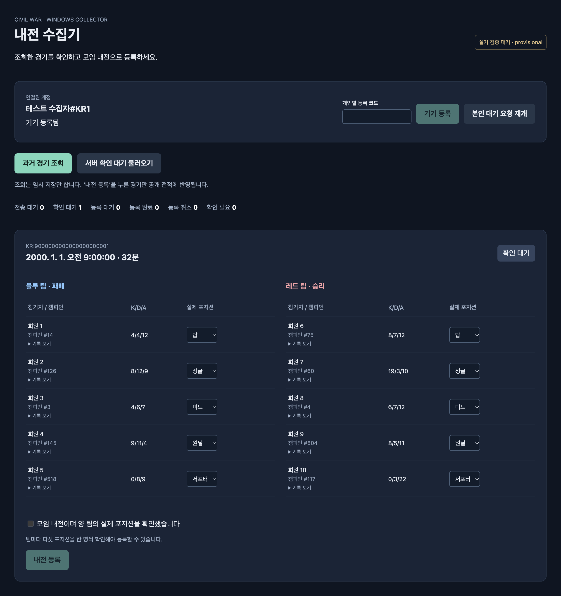
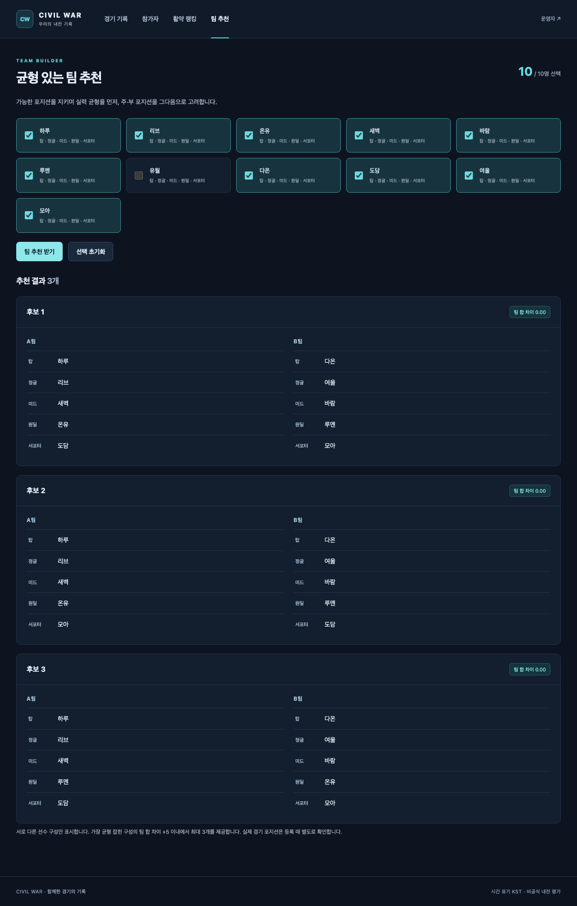
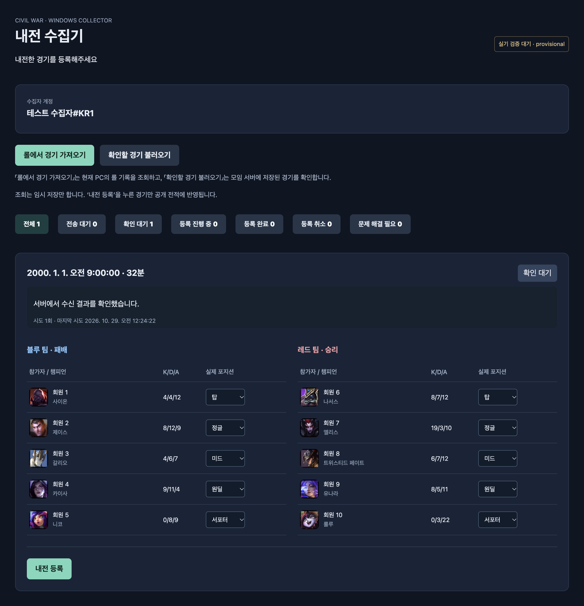
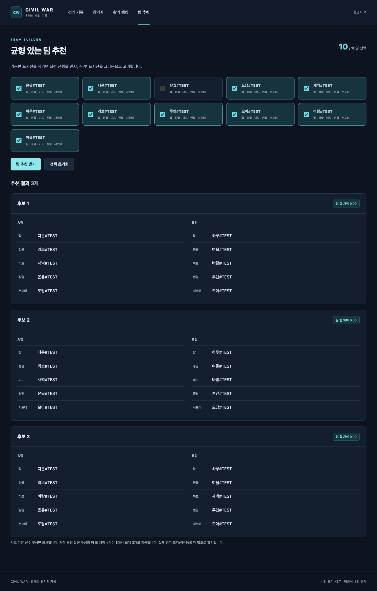

# 수집기 솔로랭크 제거와 내전 기록 부족 시 팀 추천 검증

> 첫 실행 기록의 대상은 `master`의 `9a02d36`과 당시 미커밋 변경이다. `codex/participant-collector-ux`의 현재 결과는 아래 이동 후 재검증 절과 [상태 정본](../status.md)을 따른다. 첫 실행 당시 변경 전체는 로컬 Git 보관함 `d0fd9de`에 보존했다. 편집일 2026-11-21: 사용자 요청으로 이 보관함을 백업 없이 삭제했다. 이제 당시 미커밋 변경은 이 저장소에서 재현할 수 없고, 아래 기록·수치·이미지만 당시 근거로 남는다. 본문의 코드 링크는 현재 파일을 가리키며 당시 코드의 재현 자료가 아니다.

기록일·실행일: 2026-10-29 한국 시각. 수집기에서 솔로랭크 참고 기능을 제거했다. 웹 팀 추천은 내전 기록이 없어도 결과를 만들지만, 첫 검증 대상 master에서는 솔로랭크를 조회하거나 실력 보정에 사용하지 않았다. 이후 이동한 대상 브랜치의 구현·검증은 아래에서 따로 기록한다.

| 구분 | 확인 결과 | 판단 주체·상태 |
| --- | --- | --- |
| 사용자 확정 | 솔로랭크는 웹 팀 추천에서만 활용하고 수집기 기능 제거 | [사용자 결정 보완](../superpowers/decisions/2026-10-28-ux-requirements.md#2026-10-29-보완--솔로랭크는-웹-팀-추천에서만-사용). 재승인 사항 없음 |
| 오류 수정 | 수집기 버튼·화면 공개 호출·내부 명령·항상 실패하는 처리 제거 | 개발 담당자 구현, 아래 자동·화면 검증 완료. Windows 배포 미실행 |
| 조사 및 검증 | 내전 0·1경기에서도 수동 초기값으로 추천 성공, 솔로랭크 활용은 없음 | 아래 격리 DB·서버·브라우저 관측에 한정 |

현재 제품 규칙과 미완료 상태는 각각 [명세](../spec.md#포지션별-실력-보정)와 [상태 정본](../status.md)에 있다. 이 문서는 이번 실행의 결과·근거·한계를 보존한다.

## 실행 환경과 범위

macOS ARM64에서 Node.js 24.22.1, pnpm 11.5.0, Electron 45.0.0, OpenJDK 25.0.1과 격리 PostgreSQL 18.6을 사용했다. 서버 통합 시험은 테스트용 `cw_test`, 브라우저 시험은 별도 `cw_web_test` DB를 사용했다. 운영 DB와 실제 회원 자료에는 연결하지 않았다.

Electron 시험은 실제 main·preload·화면·파일 SQLite를 실행하고 게임·서버 응답만 가상 자료를 사용한다. 서버 통합 시험은 실제 Spring 서비스·PostgreSQL과 프로세스 내부 요청 실행기(MockMvc)를 사용한다. 웹 시험은 실행 JAR·실제 HTTP·Chromium을 사용하며, Riot 외부 조회를 가상 성공으로 주입하지도 실제로 호출하지도 않았다.

## 수집기 변경 전후

변경 전에는 버튼을 누르면 조회·파일 생성 없이 항상 이용 불가 문구가 나왔다. 제거 후에는 해당 버튼과 호출 경로가 없다. 제거된 내부 `references` 명령은 `INVALID_IPC`로 거절한다. 로컬 자료 전환이나 삭제 없이 기존 내전 조회·초안·명시적 등록·오프라인 재시도 흐름을 유지했다.

기존 IPC 시험에 제거된 명령의 거절을 추가하자 변경 전에는 명령을 허용해 8개 중 1개가 실패했다. 연결 제거 후 같은 시험 8개가 모두 통과했다. 화면 검사에서는 조회·두 팀 포지션 선택·확인 후 등록과 재실행 흐름을 실행했다. [입력 검증 근거](../../apps/collector/src/main/lcu-bridge.test.ts), [Electron 실행 시험](../../tests/e2e/collector.spec.ts).

이번 실행은 새 날짜의 화면을 저장한다. 기존 시험의 반복 페이지 캡처도 실행 결과 폴더로 옮겨 과거 보고서의 이미지를 덮어쓰지 않는다.

## 팀 추천에서 관측한 실제 입력과 결과

| 상황·입력 | 실제 처리·결과 | 의미 |
| --- | --- | --- |
| 내전 0경기, 한 참가자의 수동 초기 실력 80 | 다섯 포지션 모두 표본 수 0·실력 80. 10명 추천 요청은 후보 3개 반환 | 추천 가능. 솔로랭크 참조 성공은 아님 |
| 내전 1경기, 같은 초기값 80 | 해당 경기의 탑 실력은 `(400 + 탑 경기 점수) / 6`. 나머지 포지션은 표본 0·실력 80. 후보 3개 반환 | 기존 초기값 다섯 경기분과 내전 한 경기의 혼합 |
| 내전 0경기에서 솔로랭크 정글 포지션 표본 1건 가져오기 | 포지션 제안은 정글로 생성. DB에서 입력을 다시 읽어 재계산해도 실력 목록·추천 결과는 가져오기 전과 동일 | 관리용 포지션 제안은 팀 추천 실력 자료가 아님 |
| 실제 웹에서 내전 1경기 참가자를 포함한 10명 선택 | HTTP 200, 후보 3개. 각 후보에 해당 참가자가 포함 | 기록 부족이 추천을 막지는 않지만 자동 등급 보정은 없음 |

[서버 검증 코드](../../apps/server/src/test/java/cw/teams/TeamApiIntegrationTest.java)에서 입력·계산·응답을 함께 확인했다. 솔로랭크 표본 시험은 기존 추천 캐시만 비교하지 않고 DB 스냅샷으로 실력을 새로 계산해 대조했다. [브라우저 검증 코드](../../tests/web/team-sparse-history.spec.ts)는 선택한 참가자의 실제 API 경기 수가 1인지 먼저 확인한다.

자료 흐름을 추적한 결과 [웹 추천 화면](../../apps/web/src/features/teams/Recommendation.tsx)은 참가자 ID만 서버에 전달한다. [추천 서비스](../../apps/server/src/main/java/cw/teams/TeamService.java)는 현재 평가의 포지션 실력을 사용하고, [평가 작업자](../../apps/server/src/main/java/cw/evaluation/RecalculationWorker.java)는 [실력 계산기](../../apps/server/src/main/java/cw/domain/RoleSkillCalculator.java)에 회원의 수동 `seedSkill`과 내전 점수만 전달한다. 공식 등급 조회나 솔로랭크 경기 실력을 넣는 경로는 없다.

## 실행 명령과 결과

아래 수는 각 실행기가 실행한 시험 사례 수이며 실제 게임 수나 외부 연동 성공 횟수가 아니다.

| 명령 | 실행 결과·근거 |
| --- | --- |
| `pnpm typecheck` | 통과 |
| `pnpm test` | 7개 파일의 시험 사례 64개 통과 |
| `pnpm build` | 수집기·웹 빌드 통과 |
| `pnpm format:check` | 클라이언트·시험 코드 형식 검사 통과 |
| `./apps/server/gradlew -p apps/server spotlessCheck` | Java 형식·정적 검사 통과. 아래 초기 실패를 수정한 뒤 관련 서버 시험도 다시 통과 |
| `pnpm docs:index`, `pnpm test:docs`, `pnpm docs:check` | 안내표 갱신, 문서 검사기 시험 66개와 문서 등록·링크·중복 검사 통과 |
| `pnpm test:e2e` | Electron 시험 사례 8개 통과 |
| `./apps/server/gradlew -p apps/server spotlessApply test --tests cw.teams.TeamApiIntegrationTest --tests cw.domain.TeamRecommenderTest --tests cw.members.MemberReferenceIntegrationTest` | 추천 API 5개·추천 계산 7개·참고 가져오기 3개, 총 15개 통과. [서버 XML 결과](../../apps/server/build/test-results/test/TEST-cw.teams.TeamApiIntegrationTest.xml) |
| `pnpm exec playwright test -c playwright.web.config.ts tests/web/team-sparse-history.spec.ts` | 실제 웹 시험 사례 1개 통과 |

초기 Java 정적 검사에서는 새 시험 코드의 `var` 사용 4곳이 저장소 규칙에 어긋나 실패했다. 명시적 자료형으로 고친 뒤 `spotlessApply spotlessCheck test`와 같은 세 시험 클래스 선택 조건으로 다시 실행했고 성공했다. 마지막 검토에서 화면 호출의 잔존이나 중요 오류는 발견하지 못했다. 브라우저 시험이 확인한 참가자의 포함 여부와 보고서의 표현도 대조했다.

서버·웹 실행은 위 JDK를 `JAVA_HOME`으로 지정하고 Node.js 24.22.1을 PATH 앞에 두었다. 모든 명령은 저장소 루트에서 실행했다. 콘솔의 색상 환경변수 경고는 시험 실패가 아니며, Riot 응답·게임 실기 증거로 사용하지 않는다.

## 첫 master 검사에서 확인한 미완료와 미확인

웹 팀 추천의 자동 솔로랭크 보정은 기존 [구현 계획 T04](../superpowers/plans/2026-10-28-ux-improvements.md)에 남아 있다. 실제 계정 연결·공식 조회, 등급 없음과 조회 장애의 구분, 마지막 정상값 보존이 구현·검증돼야 사용자 목표를 충족한다. 이번 요청은 제거와 현행 동작 확인이므로 신규 연동 구현을 포함하지 않았다.

실제 Riot 조회, 새 Windows 설치판 제작·설치와 운영 서버 반영은 이번에 실행하지 않았다. 기존 관리 화면의 솔로랭크 표본 가져오기와 공유 자료 변환기는 남아 있으며 이번 수집기 제거 대상이 아니다. 이 기존 기능이 새로운 팀 추천 보정을 대신한다고 판단하지 않는다.

## 대상 브랜치로 이동한 뒤 재검증

편집·보완일: 2026-10-29. 사용자는 현재 작업을 master가 아닌 `codex/participant-collector-ux`에서 진행하도록 지시했다. 대상 기준은 기존 커밋 `205b721`이며, 현재 작업 위치는 해당 브랜치의 기존 Git 작업 폴더다. master는 미커밋 변경이 없는 상태로 정리했고, 코드·문서·이미지 원본 전체는 앞서 적은 보관함에 유지했다(2026-11-21 삭제, 머리말 참조). 최신 문서를 오래된 master 문서로 교체하지 않고 이번 제거·검증 부분만 합쳤다.

이 브랜치에는 `SoloRankService`의 등급 조회·보관과 `RoleSkillCalculator`의 `teamSeed` 보정이 이미 구현돼 있다. master에서 확인한 미구현 상태를 이 브랜치의 현재 상태로 적용하지 않는다. 가져온 시험도 수동 초기값 80을 기대하는 대신 선행 구현의 공식 조회 경계에 다이아몬드 I 가상 응답을 넣어 시작값 90을 검증하도록 바꿨다. 수집기 기능 제거를 위해 이 서버 제품 코드를 바꾸지는 않았다.

외부 연동 경계만 가상 응답이고 등급 보관·재계산·추천 요청은 실제 Spring 서비스와 격리 PostgreSQL을 사용한다. 공식 키의 실제 조회 성공 여부는 이번에도 확인하지 않는다. 실제 웹 시험은 기존 합성 자료의 내전 1경기 참가자를 선택하며, 그 시험만으로 실제 솔로랭크 조회 성공을 주장하지 않는다.

첫 실행의 수치·이미지는 위에 남기고 새 결과로 덮어쓰지 않는다. 이 절의 실행도 앞서 기록한 macOS·Node.js·JDK와 격리 DB 환경에서 수행했다.

| 대상 브랜치의 상황 | 관측 결과 |
| --- | --- |
| 내전 0경기, 공식 조회 경계의 다이아몬드 I 가상 응답 | 실제 등급 저장소의 시작값 90이 다섯 포지션 실력에 반영되고 추천 후보 3개 생성 |
| 내전 1경기, 같은 가상 등급 | 탑 실력은 `(450 + 탑 경기 점수) / 6`, 나머지 포지션은 90. 추천 후보 3개 생성 |
| 관리용 솔로랭크 포지션 표본 가져오기 | 포지션 제안은 생성하지만 등급 기반 실력 계산에는 영향 없음. 등급 조회 경로와 구분 |
| 실제 웹에서 내전 한 경기 참가자를 포함해 요청 | HTTP 200·후보 3개·해당 참가자 포함 |

| 이동 후 명령·검사 | 결과 |
| --- | --- |
| `pnpm typecheck`, `pnpm build` | 자료형 검사와 수집기·웹 빌드 통과 |
| `pnpm test` | 9개 파일의 시험 사례 91개 통과 |
| `pnpm test:e2e` | 최신 수집기 화면·동작의 시험 사례 19개 통과 |
| 서버 `spotlessApply spotlessCheck test`, 다섯 클래스 선택 | 추천 API 5개·추천 계산 7개·포지션 실력 2개·등급 보관 4개·참고 가져오기 3개, 총 21개 통과 |
| `pnpm exec playwright test -c playwright.web.config.ts tests/web/team-sparse-history.spec.ts` | 실제 JAR·브라우저 시험 사례 1개 통과 |

서버 선택 조건은 `--tests cw.teams.TeamApiIntegrationTest --tests cw.domain.TeamRecommenderTest --tests cw.domain.RoleSkillCalculatorTest --tests cw.members.SoloRankIntegrationTest --tests cw.members.MemberReferenceIntegrationTest`다. 현재 결과는 [추천 API XML](../../apps/server/build/test-results/test/TEST-cw.teams.TeamApiIntegrationTest.xml)과 [등급 보관 XML](../../apps/server/build/test-results/test/TEST-cw.members.SoloRankIntegrationTest.xml)에 있다.

따라서 이 브랜치의 자동 등급 보정은 가상 외부 응답을 사용한 서버 통합 검증에서 동작한다. 실제 운영 키로 등급을 가져오는지, 제거가 포함된 새 Windows 설치판과 운영 서버가 반영됐는지는 미확인이다.
