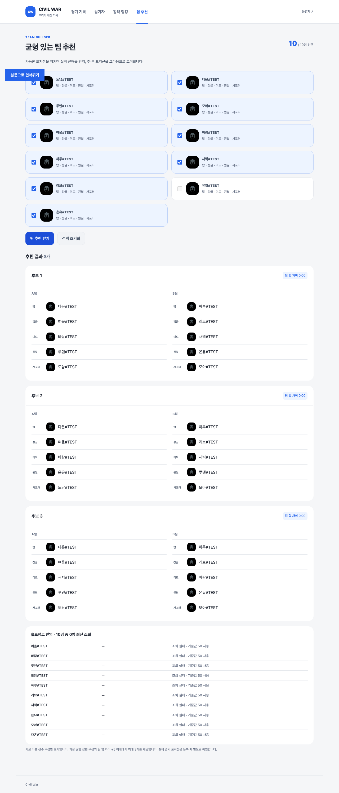

# 팀 추천 시점 솔로랭크 조회 검증

팀 추천을 요청하면 서버가 선택한 10명의 솔로랭크 등급을 그 자리에서 동시에 조회하고, 그 값으로 포지션별 실력을 계산하도록 바꿨다. 운영자가 따로 조회하지 않아도 누구나 최신 등급이 반영된 추천을 받게 하는 것이 목적이다. 함께 쓰이지 않던 관리자 기능인 초기 포지션 참고 자료를 제거했다. 이 기록은 로컬 구현과 가상 Riot 응답 검사 결과이며, 실제 Personal API Key 연동이나 운영 서버 적용을 뜻하지 않는다.

기록일: 2026-11-25. 결정 이유와 대안 비교는 [설계 기록](../superpowers/specs/2026-11-25-team-live-solo-rank-design.md), 현재 규칙은 [포지션별 실력 보정](../spec.md#포지션별-실력-보정)과 [API 계약](../contracts/api.md#점수순위와-팀-추천), 현재 상태는 [상태 정본](../status.md)을 따른다.

| 분류·주체 | 상태 | 지금 판단할 사항 |
| --- | --- | --- |
| 사용자 확정 · 사용자 | 참고 자료 제거, 추천 요청 때 조회, 실패 시 마지막 성공값·50 사용, 동시 조회와 상한, 호출 한도 대책 보류 | 재승인 없음 |
| 임시 선택 · 구현 담당자 | 상한 4초, 서버 전체 동시 Riot 요청 10개, 상한 초과 조회는 취소하고 저장하지 않음 | 바꾸고 싶은 값이 있으면 알림 |
| 조사 및 검증 · 구현 담당자 | 아래 로컬 검사 완료 | 실제 키 연동, 운영 DB의 참고 자료 행 수는 미확인 |

## 변경 전후

| 상황 | 변경 전 | 변경 후 |
| --- | --- | --- |
| 등급 조회 시점 | 서버가 1초마다 한 명씩 조회. 성공 후 24시간, 실패 후 5분 동안 재조회하지 않음 | 팀 추천 요청 때 선택한 10명을 동시에 조회 |
| Riot 요청 | 서버 전체에서 한 번에 하나씩, 요청당 5초 제한 | 서버 전체 동시 10개까지, 요청당 4초 제한 |
| 늦은 조회 | 해당 없음 | 4초 상한이 지나면 취소하고 저장하지 않음. 마지막 성공값 또는 50을 쓰고 `timeout`으로 표시 |
| 포지션별 실력 계산 | 재계산 때 저장된 등급으로 미리 계산 | 추천 요청 때 이번 조회 결과로 계산 |
| 등급 변화 | 재계산 번호를 올려 공개 평가 전체를 다시 계산 | 재계산하지 않음. 감사 기록만 남김 |
| 추천 응답·화면 | 후보만 표시 | 사람별 반영 상태(`rankLookups`)와 "솔로랭크 반영" 목록 표시 |
| 초기 포지션 참고 자료 | 관리자 편집 화면, API 2개, 테이블 2개 | 모두 제거. API는 404 |

## 환경과 결과

macOS arm64, OpenJDK 25.0.1(Gradle 도구 체인과 웹 시험의 `JAVA_HOME`), Node.js 23.11.0, Docker 28.1.1, 저장소 테스트 Compose의 PostgreSQL에서 실행했다. 서버 테스트는 `cw_test`, 웹 테스트는 `cw_web_test`만 초기화했다. 운영 서버와 사용자 PC 자료는 열지 않았다. 아래 수는 시험 사례 수다.

| 환경·검사 | 결과 |
| --- | --- |
| `./apps/server/gradlew -p apps/server clean build` | 통과. JUnit 시험 사례 189개(33개 클래스), 실패·오류·건너뜀 0 |
| `pnpm typecheck` | 통과 |
| `pnpm test` | 통과. Vitest 8개 파일, 89개 사례 |
| `pnpm test:web` | 통과. Playwright 23개 사례 |
| `pnpm format:check`, `pnpm format:java:check` | 통과 |

## 확인한 동작

모두 가상 Riot 응답(Mockito 대역 또는 로컬 HTTP 서버)으로 확인했다. 실제 Riot 서버는 호출하지 않았다.

| 상황 | 기대 결과 | 근거 시험 |
| --- | --- | --- |
| 동시 요청 수 제한 2, 300ms 걸리는 요청 4개 | 동시 진행 최대 2개, 전체 1초 미만 | `HttpRiotGatewayTest.requestsRunConcurrentlyUpToTheLimit` |
| 429 받은 뒤 다른 스레드 5개가 요청 | 모두 바로 실패, Riot 호출은 처음 1번뿐 | `HttpRiotGatewayTest.tooManyRequestsBlocksConcurrentCallers` |
| 자리 기다리던 요청이 취소됨 | 0.5초 안에 실패로 반환 | `HttpRiotGatewayTest.interruptedWaitForPermitReturnsUnavailable` |
| 조회 성공·실패·첫 실패·등급 없음 | 각각 `live`·`saved`(시드 90 유지)·`default`(50)·`live`(50) | `LiveRankLookupIntegrationTest` 4개 사례 |
| 한 명만 2초 지연, 상한 300ms | 1초 안에 응답, 그 사람만 `timeout`·`default`, 2.5초 뒤에도 결과 저장 안 됨 | `LiveRankLookupIntegrationTest.memberPastDeadlineTimesOutAndIsNotSaved` |
| Riot 키 없음 | 10명 모두 `default`, 2초 안에 응답 | `LiveRankLookupIntegrationTest.blankKeyFinishesWithoutWaitingForTheDeadline` |
| 한 명의 조회 코드가 예외 | 그 사람만 `unavailable`, 나머지 정상 | `LiveRankLookupIntegrationTest.exceptionForOneMemberOnlyAffectsThatMember` |
| 같은 10명 추천 두 건 동시 | 둘 다 10명 결과 | `LiveRankLookupIntegrationTest.concurrentLookupsForSameMembersBothSucceed` |
| 등급이 다이아몬드 I → 아이언 IV로 바뀜 | 다음 추천의 시드 90 → 0, 재계산 번호·작업 수 변화 없음 | `TeamApiIntegrationTest.freshRankChangesRecommendationWithoutRecalculation` |
| 재계산 중 추천 요청 | 202, Riot 호출 없음 | `TeamApiIntegrationTest.recalculatingSkipsRiotLookups` |
| 업그레이드 전 저장된 평가 결과(`roleSkills` 포함) | 그대로 읽힘. 어노테이션을 빼면 실패함을 확인 | `RecalculationIntegrationTest.generationJsonWithLegacyRoleSkillsIsReadable` |
| 참고 자료 API·테이블 | API 404, 테이블 없음 | `AuthMembersIntegrationTest.referenceEndpointsAreGone`, `referenceTablesAreDropped` |
| 추천 화면 | 반영 목록 10줄, 관리자 편집에 참고 자료 영역 없음 | `tests/web/team-sparse-history.spec.ts`, `tests/web/admin-web.spec.ts` |

## 한계와 미확인 사항

- **실제 Riot 연동은 미확인이다.** Personal API Key로 실제 등급을 조회한 결과와 실제 응답 시간은 측정하지 않았다.
- **호출 한도 대책이 없다(사용자 확정).** 추천 1번에 최대 20번 호출한다. 2분 100번 한도라면 2분 안에 추천을 5번 넘게 요청할 때 한도에 걸릴 수 있다. 이 한도 수치는 Riot 개발자 포털에서 확인하지 않은 가정이다. 동시 요청 제한은 한도 대책이 아니다.
- **추천에 포함되지 않은 사람의 등급은 갱신되지 않는다.** 관리자 참가자 목록의 등급은 마지막 추천 때 값이다.
- **운영 DB 확인 필요.** V11 이전은 `member_reference_links`, `role_reference_samples`를 삭제한다. 운영 DB에 행이 있는지 병합 전에 확인하지 않았다.
- 웹 시험 실행기는 2026-10-28 과거 화면 이미지도 다시 만든다. 과거 검증 근거를 보존하기 위해 그 변경은 되돌렸고, 이번 화면 이미지만 새로 추가했다.
