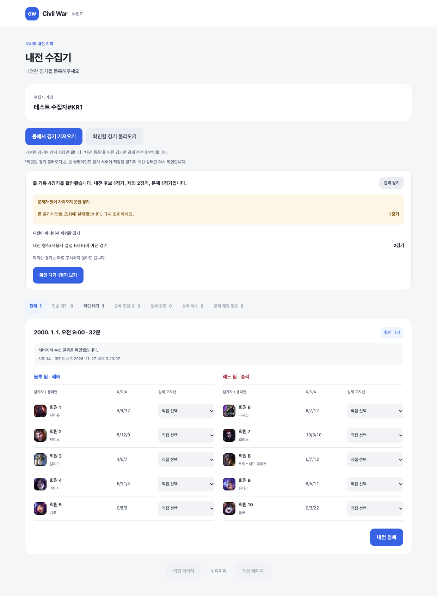
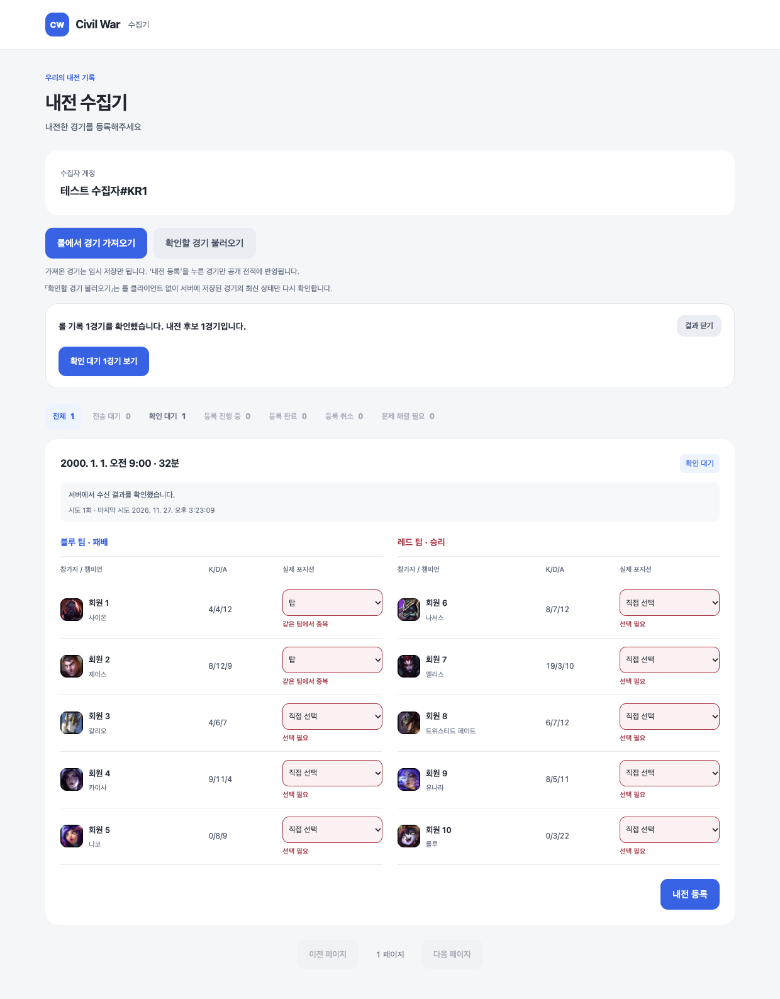

# 수집기 사용성 개선 검증 보고서

기록일: 2026-11-27. [수집기 사용성 개선 결정](../superpowers/decisions/2026-11-27-collector-ux.md)의 변경을 개발용 macOS에서 가상 응답으로 확인했다. 실제 롤 클라이언트·운영 서버·Windows 설치판에서는 확인하지 않았다. 프로젝트의 현재 상태는 [현재 구현·검증 상태](../status.md)를 따른다.

## 환경과 결과

개발용 macOS에서 수집기를 빌드하고, 롤 클라이언트와 서버를 [고정 가상 응답](../../apps/collector/src/main/fixture.ts)으로 대신해 Electron 화면을 자동 조작했다. 아래 수는 통과한 시험 사례 수다.

| 검사 | 확인한 상황 | 결과 |
| --- | --- | --- |
| 단위 시험 `pnpm test` | 조회 요약의 건수·분류·문장, 진행 알림 순서를 포함한 전체 단위 시험 | 93개 통과 |
| 화면 시험 `pnpm test:e2e` | 기존 수집기 화면 20개와 이번에 추가한 4개 | 24개 통과 |
| 형식 검사 | `tsc --noEmit`, 수집기·화면 시험 파일의 Prettier 검사 | 통과 |

추가한 화면 시험 4개는 [화면 시험](../../tests/e2e/collector.spec.ts)의 `ux:`로 시작하는 사례다.

1. 내전 1경기, 내전 형식이 아닌 2경기, 조회 실패 1경기를 돌려주는 가상 기록에서 진행 문구와 요약 문장, 사유별 건수, ` / ` 연결이 없음을 확인했다. ‘확인 대기 1경기 보기’로 필터가 바뀌고 ‘결과 닫기’로 요약이 사라졌다.
2. 정상 처리만 있는 조회에서도 요약이 표시됐다.
3. 롤 클라이언트가 꺼진 상태에서 가져오기 버튼 아래에 이유가 표시됐다.
4. 같은 팀에 탑을 두 번 고르면 두 행에 중복이 표시되고, 등록을 누른 뒤에는 미선택 8명에 ‘선택 필요’가 표시됐다.

기존 사례 가운데 연결 실패 시험에는 오류가 연결 팝업 한 곳에만 표시되는지 확인하는 검사를 더했다.

## 미확인 사항과 한계

- 실제 롤 클라이언트의 기록으로 조회한 결과 화면과 진행 문구는 확인하지 않았다. 가상 기록은 4경기이며 수십 경기 조회의 표시 속도는 미확인이다.
- Windows 설치판과 운영 서버 연결은 확인하지 않았다.
- 진행 문구 관찰을 위해 가상 응답의 경기 조회에 0.4초 지연을 두었다. 실제 조회 시간과 무관하다.
