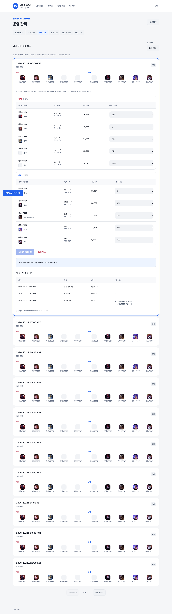
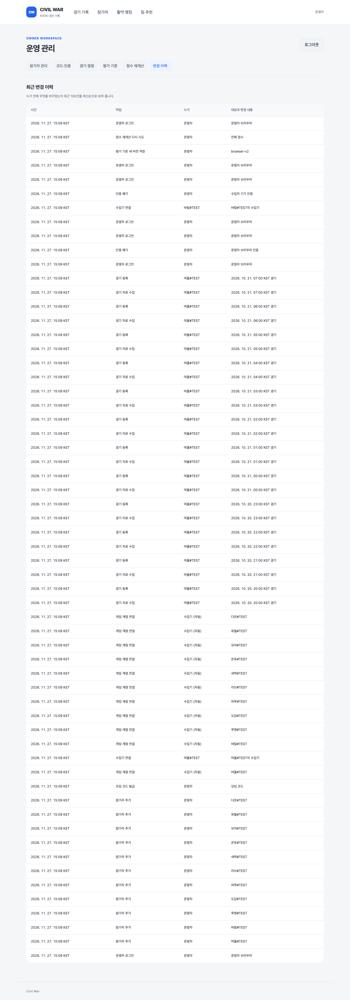
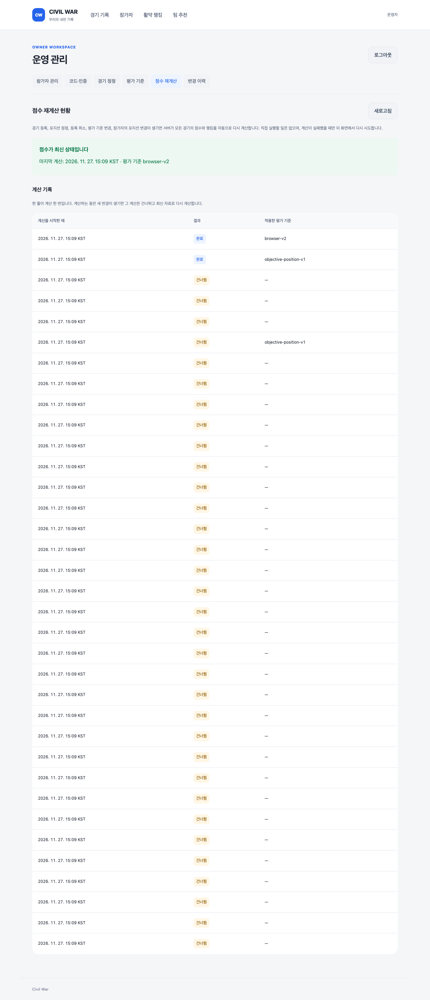
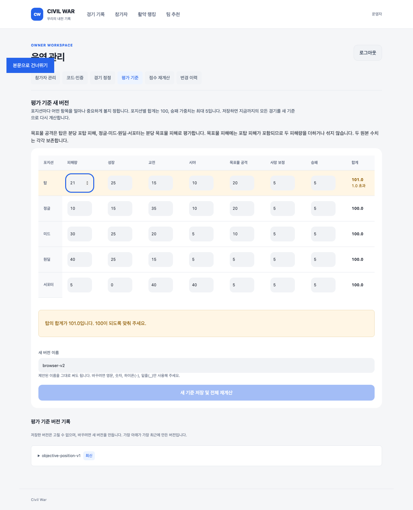
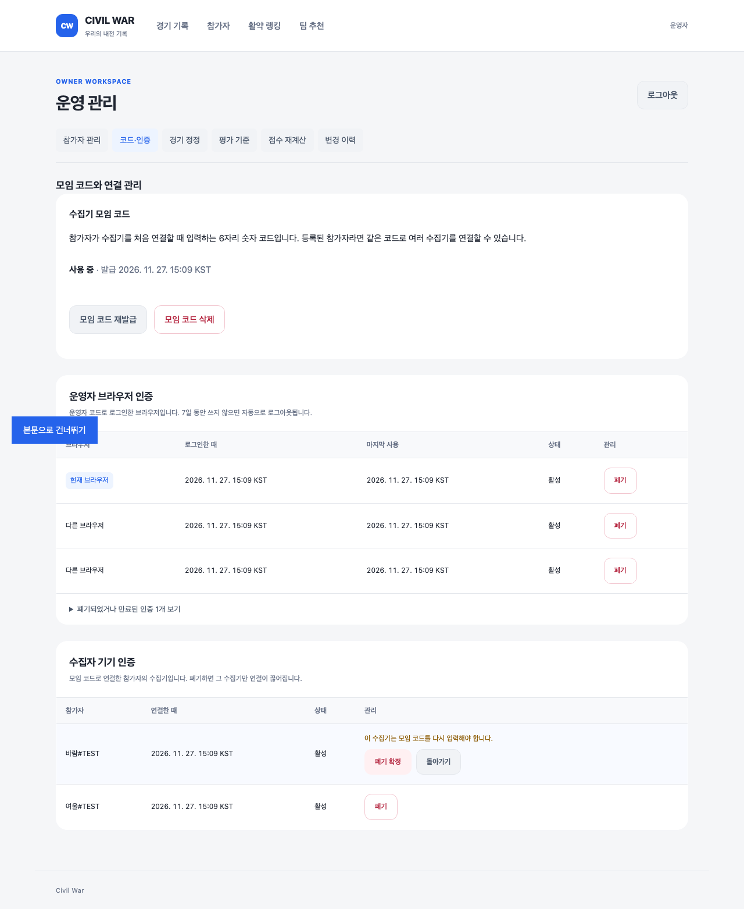
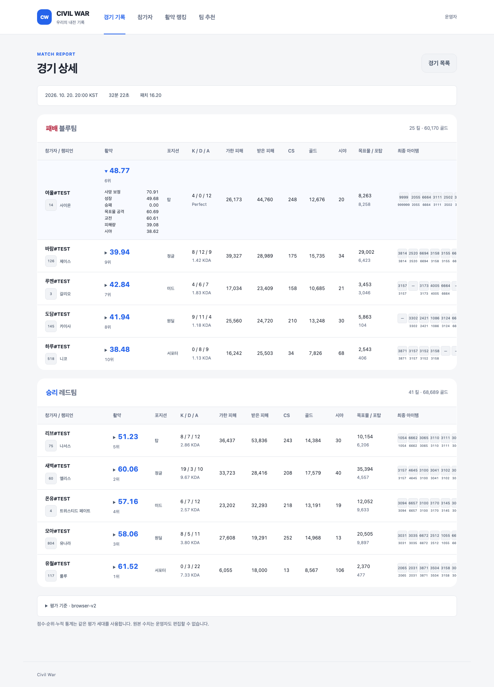
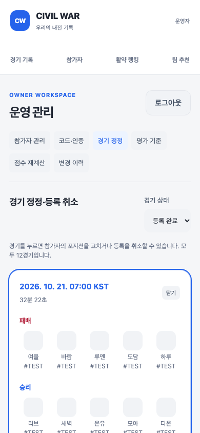

# 운영자 화면과 공개 화면의 사용성 개선 검증

운영자가 경기 정정·평가 기준·점수 재계산·변경 이력·코드와 인증 화면을 설명 없이 이해하고, 되돌릴 수 없는 조작을 확인 없이 실행하지 않도록 웹 화면을 바꿨다. 공개 화면은 활약 점수를 이름 옆에 두고, 모든 항목에 반복되던 상태 표시와 내부 값을 없앴다. 이 기록은 로컬 시험 서버와 합성 자료로 확인한 결과이며, 운영 서버에 반영한 뒤의 화면은 확인하지 않았다.

기록일: 2026-11-27. 변경 이유와 대안 비교는 [결정 기록](../superpowers/decisions/2026-11-27-operator-ux.md), 현재 화면 규칙은 [제품 명세](../spec.md#화면-디자인과-참가자-사진), 현재 상태는 [상태 정본](../status.md)을 따른다. 이 문서의 수치와 화면은 당시 실행 결과이며 이후 변경은 반영하지 않는다.

| 분류·주체 | 상태 | 지금 판단할 사항 |
| --- | --- | --- |
| 사용자 확정 · 사용자 | 요청한 여섯 가지와 승인한 열두 가지를 구현 | 재승인 없음 |
| 임시 선택 · 구현 담당자 | 화면에서 10경기씩 나눔, 원본 수치는 화면에서만 제거, 변경 이력은 화면에서 쉬운 말로 변환 | 바꾸고 싶은 항목이 있으면 알림 |
| 조사 및 검증 · 구현 담당자 | 아래 로컬 검사와 화면 확인 완료 | 운영 서버 반영 후 화면, 실제 휴대전화는 미확인 |
| 오류 수정 · 구현 담당자 | 기존 화면 시험 1건이 앞선 재계산이 끝나기 전에 팀 추천을 눌러 가끔 실패하던 문제를 대기 추가로 보완 | 없음 |

## 변경 전후

| 화면 | 변경 전 | 변경 후 |
| --- | --- | --- |
| 경기 정정 목록 | 날짜와 경기 번호가 적힌 버튼 나열, 페이지 나눔 없음 | 날짜·경기 시간·팀별 승패·챔피언·이름이 있는 카드, 10경기씩 나눔 |
| 경기 정정 | 10명 한 표, 팀을 `100`·`200`으로 표시, 원본 수치 펼쳐 보기 | 고른 카드 안에서 블루팀·레드팀 표로 표시. 한 팀에 같은 포지션이 둘이면 알리고 저장을 막음. 원본 수치 화면 제거 |
| 변경 이력 | `match_registered` 같은 작업 이름, 내부 식별자, 빈 `{}` | ‘경기 등록’ 같은 한글 이름, 누가 했는지, 참가자 이름·경기 날짜. 포지션 정정은 ‘이름: 탑 → 정글’ |
| 평가 기준 | 내부 비율 입력 영역, 직접 짓는 버전 ID, 합계 오류는 저장 후에야 확인, 버전 기록은 원본 자료 | 내부 비율 영역 제거, 버전 이름 자동 제안, 합계가 100이 아니면 강조하고 저장을 막음, 버전 기록은 가중치 표 |
| 점수 재계산 | 자료 버전·시도 횟수의 표, 항상 보이는 재시도 버튼 | 맨 위에 현재 상태와 마지막 계산 시각. 다시 계산 버튼은 최신 계산이 실패했을 때만 표시 |
| 코드·인증 | 재발급·삭제·폐기가 즉시 실행, 12자리 식별자 표시 | 영향 범위를 알린 뒤 한 번 더 확인. 현재 브라우저 표시, 마지막 사용 시각, 폐기·만료된 인증은 접어 둠 |
| 참가자 관리 | 저장하면 알림 없이 닫힘, Riot ID 형식 안내 없음 | 저장 알림, 형식 안내, 주·부 포지션이 같으면 저장을 막음 |
| 경기 상세 | 활약 점수가 표 맨 끝, 경기 번호와 긴 패치 번호 표시 | 활약 점수가 이름 바로 옆, 표를 옆으로 넘겨도 이름 열 고정, 패치는 `16.20` 형태 |
| 경기 기록·참가자·랭킹 | 모든 항목에 ‘평가 완료’·‘팀 추천 대상’·‘정식 랭킹’ 표시, ‘상세 ↗’ 링크만 눌림 | 예외 상태만 표시, 카드 전체가 눌림 |
| 계산 중 화면 | 2초마다 화면 전체가 ‘기록을 불러오는 중’으로 바뀜 | 같은 자료를 다시 받는 동안 기존 화면 유지 |
| 오류 안내 | 다섯 가지 오류만 한글 설명 | Riot ID 형식, 중복 등록, 가중치 합계, 포지션 지정 등 스무 가지에 원인과 해결 방법 안내 |

화면 전체를 한 장으로 찍은 그림 가운데 일부에는 화면 밖에 숨겨 둔 ‘본문으로 건너뛰기’ 링크가 중간에 함께 찍혀 있다. 이번 변경 전의 캡처에도 있던 현상이며 실제 화면에는 보이지 않는다.

## 환경과 결과

macOS arm64, OpenJDK 25.0.1, Node.js 23.11.0(저장소가 요구하는 24.22.1과 달라 경고가 표시됨), Docker 28.1.1, 저장소 테스트 Compose의 PostgreSQL에서 실행했다. 서버 테스트는 `cw_test`, 웹 테스트는 `cw_web_test`만 초기화했다. 운영 서버의 자료는 바꾸지 않았다. 아래 수는 시험 사례 수다.

| 환경·검사 | 결과 |
| --- | --- |
| `pnpm typecheck` | 통과 |
| `pnpm test:web` | 통과. Playwright 26개 사례. 실제 서버 JAR·Chromium·격리 DB 사용. 세 번 실행했다. 첫 실행(당시 25개)에서 기존 `light-ui.spec.ts`의 사진 시험 1건이 앞선 시험의 재계산이 끝나기 전에 팀 추천을 눌러 실패했고, 랭킹 응답을 기다리도록 보완한 뒤 두 번(25개, 26개)은 모두 통과했다 |
| `./apps/server/gradlew -p apps/server clean build` | 통과. JUnit 191개 사례(33개 클래스), 실패·오류·건너뜀 0. 서버 코드는 바꾸지 않았고 웹을 포함한 JAR을 다시 만들었다 |
| `pnpm test` | 통과. Vitest 9개 파일, 93개 사례. 같은 작업 폴더에서 동시에 진행 중이던 수집기 변경의 시험이 포함된 수이며, 이번 변경은 Vitest 사례를 추가하지 않았다 |
| `pnpm format:check` | 통과 |

`ui-states.fixture.spec.ts`의 사례는 브라우저에 가상 응답을 넣어 화면 상태만 확인하는 검사이며 서버 동작의 증거가 아니다. 계산 중에도 기록이 화면에 남는지 확인한 새 사례가 여기에 속한다.

## 확인한 동작

[운영자 화면 시험](../../tests/web/admin-web.spec.ts), [경기 정정 시험](../../tests/web/cross-stage.spec.ts), [공개 화면 시험](../../tests/web/public-web.spec.ts), [화면 상태 시험](../../tests/web/ui-states.fixture.spec.ts)이 다음을 확인한다.

- 경기 정정 목록은 13경기 가운데 10경기를 카드로 보여 주고 경기 번호를 표시하지 않는다. 카드를 열면 블루팀·레드팀 표가 나온다.
- 한 팀에 정글이 두 명이 되면 안내가 나오고 저장 버튼이 꺼진다. 올바르게 고쳐 저장하면 이 경기의 변경 이력에 ‘포지션 정정’과 ‘이름: 탑 → 정글’이 나온다. 서버에 저장된 포지션도 바뀐다.
- 등록을 취소하면 안내가 나오고 그 경기가 목록에서 사라진다. 원본 수치 화면은 없고, 운영자용 응답에는 원본 소수 자릿수가 그대로 남아 있다.
- 변경 이력에 영문 작업 이름, 경기 번호, 빈 `{}`가 없다.
- 평가 기준은 가중치 하나를 바꿔 합계가 어긋나면 저장이 막히고, 합계를 맞추면 저장된다. 버전 이름이 `v`와 날짜로 채워져 있고, 버전 기록은 표로 열린다.
- 점수 재계산 화면은 ‘점수가 최신 상태입니다’를 표시하고 다시 계산 버튼을 보이지 않는다.
- 모임 코드 재발급은 확인을 누르기 전까지 기존 수집기 인증을 유지하고, 확정한 뒤에 끊는다. 수집기 인증 폐기도 확인 뒤에 실행된다. 현재 브라우저는 한 줄만 표시된다.
- 경기 상세의 두 번째 열이 ‘활약’이고 경기 번호가 없다. 폭 390의 화면에서 표를 끝까지 옆으로 넘겨도 참가자 이름이 보인다.
- 경기 기록의 카드에는 상태 표시가 없고 카드의 빈 곳을 눌러도 경기 상세로 이동한다.
- 응답이 늦는 ‘계산 중’ 경기를 네 번 넘게 다시 받는 동안 ‘기록을 불러오는 중’이 나타나지 않고 열 명의 기록이 계속 보인다.
- 폭 390의 화면에서 경기 정정의 포지션 선택란이 옆으로 넘기지 않아도 보인다.

자동 시험과 별도로 로컬 시험 서버를 띄우고 브라우저에서 직접 눌러 보았다. 데스크톱 폭과 휴대전화 폭(375) 흉내에서 경기 정정, 평가 기준, 코드·인증, 경기 기록, 경기 상세를 확인했다. 이 과정에서 세 가지를 찾아 고쳤다. 상태 표시를 없앤 경기 기록 카드에서 경기 시간이 오른쪽으로 밀렸고, 휴대전화 폭의 경기 정정에서 포지션 선택란이 옆으로 넘겨야 보였으며, 좁은 표에서 ‘폐기’ 버튼의 글자가 세로로 줄바꿈되었다.

## 한계와 미확인 사실

- 운영 서버에 반영한 뒤의 화면과 실제 운영 자료에서의 표시는 확인하지 않았다.
- 실제 휴대전화 기기에서는 확인하지 않았다. 브라우저의 좁은 화면 흉내로만 확인했다.
- 점수 계산이 실패한 상태의 화면과 ‘다시 계산’ 버튼은 실패 상황을 만들지 않아 화면으로 확인하지 않았다. 재시도 요청 자체가 성공 응답을 주는지만 확인했다. 계산 대기·진행 중일 때 화면이 스스로 새로 고쳐지는 동작도 화면으로 확인하지 않았다.
- 팀 추천 화면에 덧붙인 ‘팀 합 차이’와 ‘기준값 50’의 설명 문구는 자동 시험이 문구를 검사하지 않는다. 팀 추천 시험이 찍은 화면에서 두 문구가 표시되는 것만 눈으로 확인했다.
- 한글로 바꾼 오류 안내는 문구별 자동 시험이 없다. 가상 응답으로 기본 문구와 응답 형식 오류 두 가지만 확인한다.
- 변경 이력은 화면이 아는 작업만 한글로 표시한다. 서버에 새 작업 종류가 생기면 영문 이름이 그대로 보인다.
- 메뉴를 누를 때마다 페이지 전체를 다시 불러오는 구조는 이번 범위에서 제외했다.
