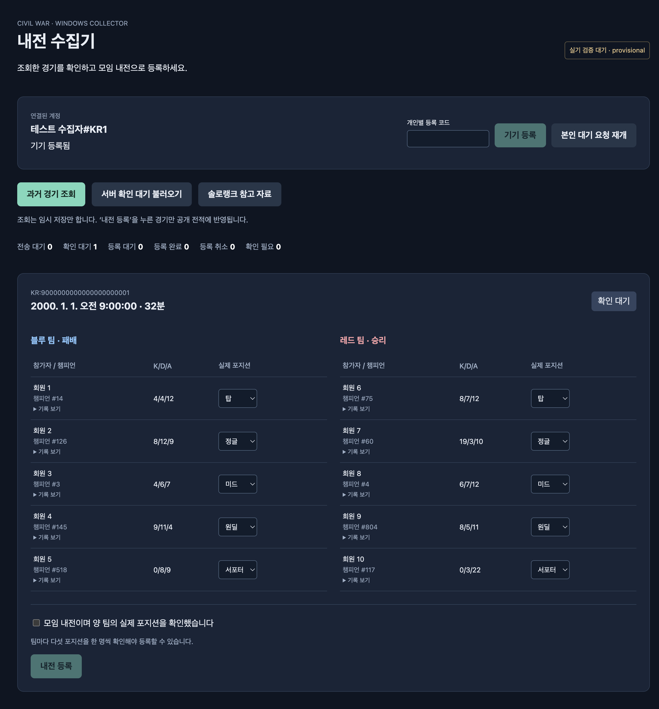

# Stage 2 — T05–T07 provisional collector verification

**Scope update, 2026-10-23:** C01/C02 lookup-timing comparisons, C10 delay/history-range measurements, and T15 pilot games are excluded by user decision. They are not pending Windows acceptance tasks. C07 damage semantics/scoring and T13–T14 installation, credential preservation, deployment, and restore remain. See [D22](../superpowers/decisions/2026-10-22-overnight-decisions.md#d22--2026-10-23-사용자-요청에-따른-검증-작업-제외).

- Date: 2026-10-22 KST.
- Base: `8e48b3a` (stage 1 final reviewed head); branch `codex/stage-2-windows-collector`.
- Scope: client workspace, TypeScript contracts/LCU adapter, Windows Electron collector, SQLite outbox, Korean review UI, fixture tests and client CI.
- Status: implemented and locally verified with fixtures. **Actual Windows + League/LCU + DPAPI manual checks remain HOLD.** No installer, signing, production deployment, real match registration, or new Riot API access was performed.
- Independent branch review and stacked PR creation belong to the coordinator. This report records author verification, not an independent review verdict.

## Reproducible checks

Repository commands run with Node 24.22.1 and pnpm 11.5.0:

| Check | Result | Boundary |
| --- | --- | --- |
| `pnpm typecheck` | PASS | TypeScript client/main/preload/renderer/tests |
| `pnpm test` | **48/48**, 6 files, skipped 0 | Includes real file-backed SQLite, mocked remote boundaries |
| `pnpm build` | PASS | Bundled main.cjs, sandbox-compatible preload.cjs, Vite renderer |
| `pnpm test:e2e` | **7/7**, skipped 0 | Actual Electron 45 main/preload/renderer, fixture LCU/server, macOS |
| `pnpm test:probe` | **31/31**, skipped 0 | Existing audited loopback HTTPS transport/CLI tests |
| `pnpm format:check` | PASS | Pinned Prettier client formatting |
| Java 25 `./apps/server/gradlew -p apps/server clean build` | **70/70**, skipped 0, BUILD SUCCESSFUL | Real isolated PostgreSQL, HTTP and packaged recovery regression |

Local Java command used `JAVA_HOME=/Users/seosanghyeog/Library/Java/JavaVirtualMachines/openjdk-25.0.1/Contents/Home` and `GRADLE_USER_HOME=/tmp/cw-gradle-cache`. Tests used the existing isolated Compose PostgreSQL on loopback port 55432. Client changes do not modify the server contract or server source.

Observed Electron runtime: **Electron 45.0.0 / Node 24.22.0 / SQLite 3.53.4**. This was read from `process.versions`, and the Electron restart UI test reopened and drained its actual on-disk SQLite database. Repository CLI tests use the separate Node **24.22.1** toolchain. No better-sqlite3 native rebuild is needed.

The initial sandboxed dependency download and loopback HTTPS test server were blocked by sandbox networking/bind permissions; the authorized reruns succeeded. The Electron UI initially had a duplicate error locator; duplicate rendering was removed and the full suite passed. These are not Windows failures or Windows passes.

`.github/workflows/client.yml` adds exact Node 24.22.1 / pnpm 11.5.0 checks and Electron fixtures on `windows-2022`, with immutable action SHAs. **Its remote execution is pending coordinator push**; a hosted Windows fixture success will still not satisfy real League/DPAPI checks.

## Acceptance map

| Plan cases / requirement | Evidence |
| --- | --- |
| T05 clientStopped, portChanged, noHistoryFetchOnLaunch | `lcu-bridge.test.ts`, service launch test and actual Electron counters; `readConnection` runs before each transport call |
| T05 noTokenInRenderer, accountMismatch | safe account/snapshot tests, protected store tests, actual preload API snapshot and malformed IPC test; renderer has no `require` |
| T05 safeStorage unavailable / decryption failure | mocked protector encrypt/decrypt storage test, failure remains visible even if League is stopped; no plaintext fallback; Windows DPAPI itself HOLD |
| T05 independent normalization | all G1–G3 match independently mapped stage 1 fixtures; string IDs, huge numeric ID parsing, missing versus zero, tuple and identity checks |
| T05 soloReferenceOnly | `role-reference.test.ts`: queue 420 only, early endings excluded, official and LCU PUUIDs separate; export reports unavailable rather than generating misleading data |
| T06 survivesRestart, sending recovery, repeatedQueryCoalesces | real temporary SQLite file reopen; queue/roles retained and `sending` reset; unique unfinished index |
| T06 lostIngestAndConfirmAck, confirmWaitsForIngest, ingestDoesNotAutoConfirm | lost-response stateful fake server; first committed state is read before retry; only one effective confirmation; actual UI counter stays zero until click |
| T06 switchedAccountCannotAdopt / same-member rotation | actor fields remain original; wrong member/token blocked, verified same-member explicit resume recorded separately; enrollment rejects other pending owner before consuming a code |
| T06 canceledStopsRetry, revoked/mismatch/invalid | permanent status table tests, canceled dependency test; no scheduled retry for attention rows |
| T06 FIFO, backoff, concurrent drains | younger game blocked behind future head, 429 Retry-After, jitter capped at 15 minutes, one shared drain promise |
| T06 restartFlushDoesNotFetchLCU | actual Electron offline stage + explicit confirm + close + reopen: `['ingest','confirm']`, LCU history calls **0** on restart |
| T06 retention / disk failures | only aged registered succeeded raw payload cleared; pending payload survives; failed disk enqueue produces LOCAL_SAVE_FAILED and no saved card |
| T07 buttonFetchesAndStages / noAutoRegistration / allRolesConfirmed | service tests and Electron 5+5 selection + explicit checkbox; all ten roles validated again in main |
| T07 offlineThenResume / delayed server | cached roster collection persists while remote promises remain unresolved; window initializes from local state before remote refresh |
| T07 queryFailureIsNotPending / unregistered participant | detail/history failures do not enqueue, empty roster rejects unknown members, UI shows lookup error |
| T07 duplicateShowsExistingState / server pending after LCU expiry | pending API reload, fresh GET for saved keys, external registration/cancellation observed, server-confirmed roles win over drafts |
| Additional raw precision | original response text survives SQLite reopen and outgoing HTTP envelope; arbitrary raw decimal and huge extra integer tokens unchanged |
| Additional IPC/DTO boundary | malformed roles/unknown properties/wrong sender/subframe rejected; server private extra fields stripped using explicit DTO allowlist |

Meaningful regressions were observed failing before fixes: strict FIFO head delay, external state refresh, stopped-LCU explicit confirmation, delayed-server startup, local ownership rejection before code consumption, decryption error priority, bounded jitter, confirmation requiring a registered follow-up read, preserving a server record on first local ingest, and distinct LCU/official reference identities. The first implementation test suites also failed on missing modules before implementation.

## Behavior and preservation rules

- Startup initializes protected credential/local state and recognizes only the LCU account. Server roster/pending refresh and saved outbox retries are separate; there is no automatic LCU history or automatic new confirmation.
- Explicit history lookup paginates in 20-item pages, deduplicates exact string IDs, rejects stalled pagination, fetches full details, verifies current account again, and writes eligible ingests durably before upload. A cached roster avoids waiting for a slow remote server; the server remains the final membership authority.
- LCU transport is the existing reviewed `tools/lcu-probe/client.mjs`; only its loopback HTTPS requests relax certificate verification, with no global TLS setting or arbitrary-host path. This collector does not call friends or other-player solo routes.
- SQLite WAL + FULL synchronous mode and transactions preserve owner `(memberId,credentialId,puuid)`, original submissions, confirmation dependency, draft roles, retry state, and cached server records. A successful ingest tombstone coalesces later queries; those queries refresh server state through GET rather than re-uploading or overwriting raw data.
- Draining is strict FIFO among pending jobs and stops at a delayed/transient head. Permanent errors move to attention; dependent confirmation also stops. Retries use 5s/15s/1m/5m/15m with bounded positive jitter, maximum 15m; 429 respects Retry-After independently. Startup recovers `sending` to `pending`.
- A stored owner may explicitly confirm/retry already saved data while League is stopped. A known different LCU account blocks it. Same-member credential rotation requires the **본인 대기 요청 재개** action after a fresh authenticated member/PUUID check. Original actor columns never change.
- Lost ingest/confirm responses are retried using the saved submission. Ingest success remains confirmation-pending. Before confirm, GET handles already registered/canceled. After sending confirm, registered GET is required before marking success. Registered views always use server-confirmed roles.
- Renderer receives a safe account and explicit normalized match DTO, never a token, full roster, raw response, arbitrary endpoint, filesystem handle, or generic IPC function. Main validates sender webContents ID, exact local frame URL, top-level frame, command schema and roles. `contextIsolation` and `sandbox` are true; `nodeIntegration` is false; navigation, popups and permissions are denied; renderer CSP blocks networking.
- Protected token file is Windows safeStorage ciphertext. DPAPI protects against other OS users, not malicious applications with the same Windows user authority. No plaintext fallback is present. See [Electron safeStorage](https://www.electronjs.org/docs/latest/api/safe-storage) and [IPC/context isolation guidance](https://www.electronjs.org/docs/latest/tutorial/context-isolation).

## Screenshot review

Captured from the real Electron fixture UI and visually inspected by the implementer; the coordinator separately reported clear 5+5 layout, readable contrast and no visible clipping. All names/IDs/date in the image are synthetic fixture data. The screen shows 확인 대기, ten selected roles, and an unchecked inhouse confirmation with the registration button disabled. It is not a real match or Windows screenshot.

## Exact outstanding Windows manual run — HOLD

Use the target Windows installation and existing collected records or isolated test records for installation/update and credential-preservation checks. No new normal game, lookup-timing comparison, history-range measurement, or fixed game count is required. Keep raw capture/credentials in private storage; do not put them in this report.

1. Install exact Node/pnpm; `pnpm install --frozen-lockfile`, `pnpm build`; set `CW_SERVER_ORIGIN` and `CW_LCU_LOCKFILE`; `pnpm dev:collector`. Verify default `%APPDATA%\Civil War Collector` location and SQLite reopen on the target filesystem.
2. Verify account states and **zero history/detail calls before the button**. Verify renderer devtools sees no LCU credential/device token/raw match and cannot use Node or arbitrary IPC. The previously excluded real-client restart comparison is not required.
3. Enroll with the owner's code; restart under the same Windows user and verify actual safeStorage decryption. Verify unavailable/corrupted protected storage gives re-enrollment, not plaintext. Verify a mismatched LCU account cannot consume the owner's enrollment code. Actual DPAPI/user-profile behavior remains untested here.
4. After first online enrollment/roster cache, block the server and collect via the button. Verify 전송 대기, review all 5+5 roles and explicit inhouse checkbox, then verify 등록 대기. Exit/restart while offline; reconnect and observe ingest before confirm and registered state. A second unconfirmed match must remain 확인 대기.
5. Interrupt the network after server ingest and after server confirmation commits; reconnect and verify one server match/registration, preserved original roles, and no new history call during retry. Repeat query and another participant's upload; confirm no scores/roles/raw overwrite.
6. With pending work, switch LCU accounts, revoke credentials and enroll a new same-member credential. Verify no cross-owner send; only explicit owner-verified resume works. Stop League and verify saved original-owner upload/confirmation still works. Test cancel response, disk-full enqueue failure, and expired LCU history with server pending reload.

## Stage 3 handoff

- Existing wire contract remains [stage1-api.md](../contracts/stage1-api.md) / JSON Schema / Java records. Stage 2 adds no server routes or migrations. T08–T12 should add migration V2+ and maintain revision/idempotency/authorization semantics.
- `packages/contracts/src/index.ts`: Role, normalized participant/match, private collector input/response, principal and `RoleReferenceSample`; `decode.ts`: runtime allowlisted member/match decoders. These are **private collector DTOs**. Public web DTOs must stay separate and omit PUUID/raw/auth.
- `RoleReferenceSample` aligns with the existing Java handoff fields `puuid,source,gameId,playedAt,role,evidence`. `puuid` is the member's LCU identity; `evidence.officialPuuid` is a separately resolved official API identity. `roleReference(raw,officialPuuid,lcuPuuid)` accepts only known queue-420, non-early, >=5-minute observations with known roles. It does not verify the account linkage itself and does not apply member preferences.
- Export currently returns `{available:false,code:'OFFICIAL_API_UNAVAILABLE',reason}`. C11 portal evidence did not resolve direct HTTP access; no new attempts or bypasses were made. T12 must not expect a successful file import produced by this collector yet. A later approved official API integration must resolve Riot ID via Account-v1, keep identities distinct, place keys in main/server only, handle rate limits and preserve manual operator approval.
- Preload interface: `getAccount`, `snapshot`, `enroll`, `queryPastMatches`, `loadPendingMatches`, `saveDraft`, `confirmRegistration(matchKey,rolesByPuuid,inhouse)`, `resumeOwnRequests`, `exportMemberReferences`. There is no renderer transport or credential getter.
- Local DB schema version **1** is in `outbox-migrations.ts`; future changes must migrate forward, preserve owner fields and unfinished requests, and keep the stable userData path. Confirmed roles never become initial role suggestions automatically.
- Main-local methods are `Outbox.enqueueCollected(input,actor,normalizedMatch)`, `enqueueConfirmation(matchKey,input,actor)`, `listOutbox()` and `Uploader.drainOutbox()`. SQLite methods are synchronous transactional operations; service/IPC methods are async. The already validated normalized match is passed separately to avoid parsing a preserved raw body twice. These are internal implementation interfaces, not additional HTTP endpoints.
- Remaining work: C07 damage semantics and scoring finalization, Windows installer/update and credential-preservation checks T13, production origin/configuration and backup/restore T14. C01/C02/C10 and pilot T15 are excluded by user decision. No operating-readiness claim is made.
